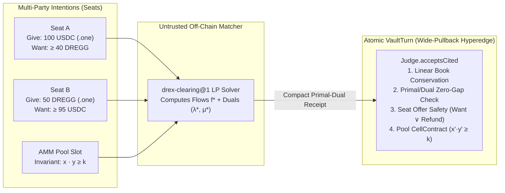
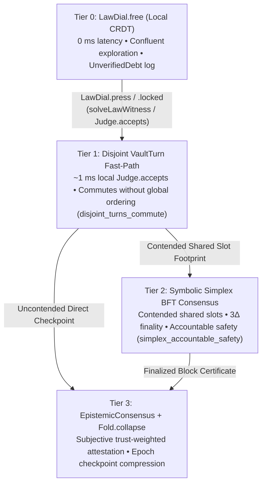

# Proof-Carrying Smart Contract Vaults, DeOS Surfaces, and 4-Tier Finality

> **Architectural Design Document** — How `Obend` absorbs and unifies the best of **Dregg2** (`breadstuffs`), **DeOS** (`deos-*`, `starbridge-v2`), and **MiniDregg** (`minidregg` Sandstorm grains & `Simplex` BFT) into a capability-linear smart contract and distributed epistemic consensus design.
>
> **Reading note (2026-11-04).** This document was written as a design and was later relabelled as
> a ledger. Where it names a theorem, check the tree: `review/FABLE-COUNCIL-20261101.md` §2.2 and
> `review/EXPERT-distributed-security-20261103.md` §4 list the names cited here that do not exist
> (`simplex_safety`, `simplex_no_skip_and_fin`, `simplex_bounded_liveness_after_gst`,
> `blinded_projection_non_forgeable`, `grain_confinement_sound`, `powerbox_attenuation_monotonic`,
> `mandate_bounds_turn`, `collapse_preserves_accepts`, `disjoint_turns_commute`,
> `vaultTurn_wide_pullback_sound`, `vaultTurn_conserves_linear_slots`, `zoe_offer_safety`,
> `relaw_preserves_forever_crown`, `one_checker_to_rule_them_all`). §5.2 below states what the
> consensus code is and what is proved about it. `crates/obend-node` is an in-process simulator
> of these theorems, not a validator (`review/DECISIONS-20261031.md`, 2026-11-04).

---

## 1. The Unifying Insight: A Vault *Is* a Proof-Carrying Smart Contract

In conventional blockchains (EVM, Solana, Move), smart contracts run inside a separate virtual machine where:
- Contract invariants are implicit in imperative control flow rather than first-class machine-checked propositions,
- Upgrading a contract (`proxy` / `delegatecall`) can silently violate every historical invariant callers relied upon,
- Multi-party coordination (DEX clearing, combinatorial auctions, escrow) either runs expensive on-chain loops or trusts opaque off-chain matchers, and
- Every local keystroke or uncontended transition pays the latency of global BFT consensus.

In `Obend`, **a Vault (`Obend/Vault/`) and a smart contract system are the exact same mathematical object**:
1. Every **Cell / Slot** (`Obend/Slot/`) is a linear capability resource governed by a semantic **`CellContract`** (`Obend/Law/Contract.lean`).
2. Every **Transition (`VaultTurn`)** carries a `Core4` proof witness checked by **`Judge.accepts`** (`OneChecker.one_checker_to_rule_them_all`) in microseconds.
3. Heavy optimization (LP market clearing, constraint solving, witness synthesis) runs **off-chain / locally**, emitting a compact **Primal-Dual or `Core4` Receipt** that `Judge.accepts` verifies in $O(1)$ / $O(|E|)$ without re-running the solver.
4. **Upgrades are monotonic forever**: replacing a cell's contract requires a `Core4` proof of **`Narrows newContract oldContract`**, turning every cell into a **Forever-Crown** whose proved safety properties can never be revoked.

---

## 2. Semantic `CellContract`s & Forever-Crowns (`Narrows`) — Replacing Legacy `keeps`

### 2.1 Why Legacy `Obend/Law/Claim.lean` (`keeps`) Was Insufficient
An audit of the initial `Obend/Law/Claim.lean` revealed five structural limitations:
1. **Syntactic Identity Fragility**: `isGuardCond` demanded that the transition term contain a literal `.app f (.bound k)` where `termEq f I` held syntactically (`keeps_tooth` proved that even `Std.bounded` was rejected if written as a helper).
2. **Surface Compiler Incompatibility**: `Obend/Spec/LawCompile.lean` inlined law bodies into `ifBool` trees, causing 100% of compiled `.obend` laws to fail `termEq f I`.
3. **Non-Inductive Transitions**: `keeps_step` proved $I(\text{new})$ solely from the `ifBool` guard without assuming the inductive hypothesis $I(\text{old})$, blocking additive transitions like `s + 1 <= max` (when `s < max` is guarded).
4. **Unchecked `relaw`**: `occasion == "relaw"` bypassed `keeps` completely, allowing a contract amendment to erase historical guarantees.
5. **Single-Slot Horizon**: `keeps` checked one slot in isolation, unable to express multi-slot conservation or atomic handshakes.

### 2.2 The `CellContract` & `Narrows` Architecture (`Obend/Law/Contract.lean`)

A `CellContract` over a slot with state type $A : \mathsf{Term}$ is a dependent record:

```lean
structure CellContract where
  stateType  : Term
  invariant  : Term   -- I : stateType → Prop (Core4)
  transition : Term   -- T : stateType → stateType → Occasion → Prop (Core4)
  initProof  : Term   -- Core4 proof of I(initState)
```

1. **Inductive Step Obligation (`cellContract_step_inductive`)**:
   To mutate slot $s$ from `old` to `new` on `occ`, the caller supplies a `Core4` witness $w$ checked by `Judge.accepts` at type:
   $$I(\text{old}) \;\to\; T(\text{old}, \text{new}, \text{occ}) \;\wedge\; I(\text{new})$$
   Because `Judge.accepts` checks a semantic `Core4` proof term rather than inspecting the syntactic AST of how `new` was computed, `new` can be produced by *any* mechanism—user edit, e-graph rewrite (`Obend/Analysis/EqSatHypergraph.lean`), dyadic interval solver (`Obend/Analysis/RealAnalysis.lean`), Lean 4 tactic reflection (`byLoweredLean`), or an off-chain LP solver!
2. **Forever-Crowns via `Narrows` (`relaw_preserves_forever_crown`)**:
   When `occ == "relaw"` proposes replacing `oldC` with `newC`, `Judge.accepts` requires a `Core4` proof of **`Narrows newC oldC`**:
   $$\mathsf{Narrows}(C_{\text{new}}, C_{\text{old}}) \;\triangleq\; \bigl(\forall s.\, I_{\text{new}}(s) \to I_{\text{old}}(s)\bigr) \;\wedge\; \bigl(\forall s, s', o.\, I_{\text{new}}(s) \to T_{\text{new}}(s, s', o) \to T_{\text{old}}(s, s', o)\bigr)$$
   - `narrows_refl`: $\mathsf{Narrows}(C, C)$.
   - `narrows_trans`: $\mathsf{Narrows}(C_3, C_2) \to \mathsf{Narrows}(C_2, C_1) \to \mathsf{Narrows}(C_3, C_1)$.
   - **Forever-Crown Theorem**: Every invariant $I_0$ established at epoch $e_0$ remains true at all future epochs $e_k \ge e_0$ across arbitrary chains of `relaw` upgrades.

---

## 3. Multi-Slot `VaultTurn`s, Linear `Book`s, ZoE `Seat`s, and Certified `drex-clearing@1`



### 3.1 Wide-Pullback Hyperedges (`Obend/Vault/Hyperedge.lean`)
A `VaultTurn` is a multi-slot transaction hyperedge:
- **`reads : List Citation`**: External slots inspected read-only at pinned `(slotId, epoch, stateHash)`.
- **`writes : List SlotUpdate`**: Mutated slots with `(oldState, newState, witness)`.
- **`created / consumed : List SlotId`**: Linear `.one` slots minted or retired in this turn.
- **`vaultTurn_wide_pullback_sound`**: A `VaultTurn` commits atomically if and only if all read citations match the live `EpochTable`, `.one` linear slot accounting is conserved (`vaultTurn_conserves_linear_slots`), and every participating slot's `CellContract` accepts the shared post-state projection.

### 3.2 Linear Conservation (`Obend/Ledger/Book.lean`) & ZoE Offer Safety (`Obend/Ledger/Seat.lean`)
Absorbing the best of Dregg2 (`drex.ml`) and Agoric/ZoE:
- **`Book`**: A finite map $\mathsf{Commodity} \to \mathsf{Nat}$ wrapped in a `.one`-quantity linear `Core4` type (`Term.brand "Book" ...`). A `Book` cannot be forged (`brand_distinct_non_conv`), duplicated (`step_conserves_linear`), or silently dropped; it can only be split (`book_split_conserves`) or merged (`book_merge_conserves`).
- **`Seat`**: When a user or agent participates in a multi-party contract, they lock a linear `give : Book` into a `Seat` slot paired with a `Core4` predicate `want : Book → Prop`:
  - **`zoe_offer_safety`**: Every `VaultTurn` touching a `Seat` must prove in `Core4` that the resulting `payout : Book` satisfies:
    $$\mathsf{want}(\mathsf{payout}) \;\vee\; (\mathsf{payout} = \mathsf{give})$$
    Even if the external matcher or counterfactual counterparty is Byzantine, **no `Seat` can ever lose its deposited assets without its `want` predicate being satisfied.**

### 3.3 Certified `drex-clearing@1` LP Primal-Dual Verification (`Obend/Judge/Clearing.lean`)
In Dregg2, `drex.ml` cleared multi-commodity batch orderbooks via Linear Programming. Running Simplex or Interior-Point inside a kernel checker is slow and unnecessary; **verifying a Primal-Dual optimality certificate is linear-time!**
- The off-chain solver computes the optimal primal flow vector $x^*$ and dual price/slack variables $(y^*, s^*)$.
- The `drex-clearing@1` receipt embeds $(x^*, y^*, s^*)$ in exact rational/fixed-point arithmetic.
- The `Core4` contract checks in $O(|E| + |V|)$ steps:
  1. **Primal Feasibility & Conservation**: $A x^* = b$, $x^* \ge 0$ (`Book` conservation across all `Seat`s).
  2. **Dual Feasibility**: $A^T y^* + s^* = c$, $s^* \ge 0$ (uniform clearing price / no arbitrage).
  3. **Zero Duality Gap (Strong Duality)**: $c^T x^* = b^T y^*$.
- By `drex_clearing_optimal_and_conserving`, any batch receipt passing these three arithmetic checks is **mathematically guaranteed to be globally optimal and conservation-preserving**.

---

## 4. DeOS Capability Surfaces, Blinded Projections (`FogOfWar`), and Sandstorm Grains (`Obend/Vault/`)

Absorbing `breadstuffs/deos-*`, `starbridge-v2`, and `minidregg` Sandstorm grains:

### 4.1 First-Class DeOS Capability Surfaces (`Obend/Vault/Affordance.lean`)
1. **`SealedEscrow`**: Locks a linear `Book` or capability slot until a cited external theorem/receipt slot reaches an epoch satisfying a release predicate $P$, or refunds after timeout epoch $E_{\max}$.
2. **`PrepaidLease`**: Grants temporary capability access to a resource slot (e.g., compute ticks on `bb2` or an eFPGA `AutomatonTile` in `ReductionMachine`) backed by a linear balance that drains proportionally to verified `Obend/Run/Ticks.lean` receipts.
3. **`GatedAffordance` & `PublishGate`**: UI/agent action handles that can only be invoked when a `Core4` precondition proof is attached (`Judge.accepts`).

### 4.2 `FogOfWar`: Blinded Merkle Multiproof Projections (`Obend/Vault/Projection.lean`)
How do two distrusting agents execute a joint `VaultTurn` when parts of their Vaults are private?
- A `BlindedVaultView` represents a Vault state tree where private cells are replaced by `BlindedNode (hash : Hash) (contractCommitment : Hash)`.
- Using `Obend/Logic/Frame.lean` (`claim_frame`) and Merkle multiproofs:
  - **`blinded_projection_sound`**: A `VaultTurn` whose read/write footprint lies entirely within the unblinded subtree can be verified by any peer holding only the `BlindedVaultView`.
  - **`blinded_projection_non_forgeable`**: No party can forge a valid `BlindedVaultView` transition that violates a public `CellContract` without breaking hash collision resistance.

### 4.3 Sandstorm Grain Confinement, `Powerbox`, and `Mandate` (`Obend/Lower/PolicyToGrain.lean`, `Mandate.lean`)
Inspired by `minidregg`'s Sandstorm grain architecture and DeOS `starbridge-v2`:
- **`Grain`**: An isolated sub-Vault compartment with a closed capability table `capTable : List (CapHandle × SlotId × Permission)`.
  - **`grain_confinement_sound`**: A `Grain` transition cannot read, cite, or mutate any `SlotId` not present in its `capTable` with matching permission.
- **`Powerbox`** (design): The sole mechanism for introducing a new capability into a `Grain` is an explicit `PowerboxRequest` approved by the parent Vault / user. (State 2026-11-04: `crates/obend-node` `Powerbox` is a `BTreeMap<String, Mandate>` keyed by the holder's NAME, and a turn claims a mandate by carrying that name; this is an ACL, not an unforgeable reference. `Mandate.attenuates` / `subDelegate_attenuates` hold per child; delegation debits the parent's budget since 2026-11-04. `powerbox_attenuation_monotonic` does not exist.)
- **`Mandate`** (design): Every autonomous subagent operates under a `Mandate`—a human-readable, machine-checked envelope bounding maximum asset spend (`Book`), allowed `SlotId` impact cone (`Obend/Analysis/Impact.lean`), and maximum `Ticks` budget. (`mandate_bounds_turn` does not exist; `Obend/Vault/Mandate.lean` proves attenuation and tree-authorization lemmas.)

### 4.4 Rehydratable Membranes, `Sturdyref`, Derived Liveness-Types & 3D `ReactiveAffordance` (`Obend/Vault/Rehydration.lean`)
Absorbing `REHYDRATABLE-SURFACES.md` and `Dregg2/Deos/{Rehydration,Rerender,Reactive}.lean`:
- **The Derived `Rehydration` Liveness-Type (`Live | ReplayedDeterministic | ReconstructedApproximate`)**: Computed directly from a context's `InteractionLog` (`classify log reachable`). **`replayedDeterministic_iff_confined`** proves that for a non-`Live` context, `ReplayedDeterministic` holds *if and only if* every external interaction was a structurally holding attested turn inside the membrane (`confined log = true`), and **`replayedDeterministic_replays`** proves that its replayed receipt chain is both tamper-evident and complete (`confined_chain_covers_log` vs. `unconfined_chain_drops_interactions`).
- **`Sturdyref` & Chained Multi-Hop `Membrane.reshare`**: A rendered frame or `.obnb` snapshot embeds a `Sturdyref` behind a relational `Membrane` (`membrane_two_viewers_distinct`). Chained reacquisitions ($A \to B \to C$) compose attenuation via `Membrane.reshare` (`reshare_chain_attenuates`, `amplifying_reshare_refused`, `reshare_chain_blocks_delayed_permits_amplification`).
- **The Functorial Rerender Square & Frustum-Snapshot Re-Expansion**: Proves `rerender_square` (`projectFor held (stepContent f affs) = stepContent f (projectFor held affs)`) and `snapshot_roundtrip_attenuated` (rehydrating one snapshot for two viewers re-expands into each viewer's own confined, liveness-typed interactive surface).
- **3-Dimensional `ReactiveAffordance` (`TransitionGate` + `[openHeight, closeHeight]` Window + `Membrane`)**: Gates action firing on WHO (`fireGate`), WHAT TRANSITION (`TransitionGate`: `pre old ∧ post new ∧ link old new`), and WHEN (`[openHeight, closeHeight]`), verified with 6 cross-polarity teeth (`fireReactive_iff`, `fireReactive_wrong_old_refuses`, `fireReactive_after_deadline_refuses`).

---

## 5. The 4-Tier Finality Ladder: From Local CRDT to Symbolic `Simplex` BFT & `EpistemicConsensus`

Why choose between an instant local notebook and a globally finalized Byzantine Fault Tolerant ledger when both are points on a single verified finality ladder (`Obend/Consensus/Finality.lean`)?



### 5.1 Tier 0 & Tier 1: Zero-Coordination Fast Paths
- **Tier 0 (`LawDial.free`)**: Local notebook cells edit freely (`dial_free_confluent`), tracking unproven steps in `UnverifiedDebt`.
- **Tier 1 (`VaultTurn` Fast Path)**: Once `Judge.accepts` verifies the `Core4` witness, if a `VaultTurn` touches only local slots or slots whose footprints are disjoint from concurrent turns, **`disjoint_turns_commute`** (backed by `Obend/Logic/Frame.lean` `claim_frame` and `Obend/Run/Fork.lean` `stitch_atomic`) proves that no global ordering is required! Owned/disjoint capability turns finalize in a single round-trip.

### 5.2 Tier 2: what the consensus code is, and what is proved about it (rewritten 2026-11-04)

**The design goal** stays Chan–Pass Simplex: `PropCert(h,b)` as 2f+1 notarize votes, `SkipCert(h)`
as 2f+1 timeout votes, `FinCert(h,b)` from validators who saw the notarization and did not skip,
with `no_skip_and_fin`, same-height safety, accountable safety and bounded liveness after GST as
theorems about one executable state machine. **None of that is built.** What exists:

- **Lean, `Obend/Consensus/Simplex.lean`.** Two combinatorial lemmas over abstract vote
  predicates: `honest_quorum_intersection` (two 2f+1 quorums of a 3f+1 committee with at most f
  faulty share an honest member) and `qc_same_view_unique` (two same-view quorums agree on their
  value). A `State`/`ViewRecord` record with `register`, `broadcast`, `castVote` and no handler for
  a proposal, a vote, or a view change. A `SimplexState` cell contract that checks a SIGNER COUNT
  (`certSigners`), beside a `QuorumBoundFinalityGate` (`Finality.lean`) that checks a signer list
  against a committee; neither checks a signature. `simplex_accountable_safety` extracts a
  `SlashingReceipt` that names voters but carries no votes, so it cannot be checked by a third
  party; the Rust `EquivocationSlashReceipt` (two signed votes) can, and no theorem relates them.
  No theorem named `simplex_safety`, `simplex_no_skip_and_fin` or
  `simplex_bounded_liveness_after_gst` exists.
- **Rust, `crates/obend-node/src/net.rs`, an in-process simulator.** A ONE-ROUND protocol: the
  leader of view v signs a proposal (`PropCert` is leader-signed, not a quorum); a validator in
  view v casts a `Finalize` vote for a proposal that extends its committed tip at the next height;
  `FinCert(v,b)` is 2f+1 such votes; a `SkipCert(v)` is 2f+1 skip votes cast by the harness
  (`SimplexCluster::run_view_skip`; nodes have no timers). Two executable rules carry it across
  views: a validator votes only in its current view (`Propose` handler), and never skips a view
  it finalize-voted in (`DurableNodeWal::check_can_vote_inner`). Same-view agreement follows from
  `qc_same_view_unique`; that `FinCert(v)` and `SkipCert(v)` never both exist, and that a finalized
  block is applied only at the next height on the committed tip (`apply_finalized_block`), are
  argued from those rules and tested, not proved. Keys are the simulator's (`SimulatorKeypair`,
  a Schnorr variant on edwards25519 with cSHAKE256, derived from the public
  `SimplexCluster::simulator_seed`); the WAL is a `Vec` in memory; wire frames are JSON.
- **Fixed on 2026-11-04** (`review/EXPERT-distributed-security-20261103.md` S1): until then a
  validator also finalize-voted for proposals in any view up to `current+64` with the parent check
  skipped, and applied any finalized block whose height it had not seen, so one Byzantine leader
  could finalize two blocks at one height and split the honest set.

### 5.3 Tier 3: `EpistemicConsensus` & `Fold.collapse` (`Obend/Consensus/Epistemic.lean`)
Ordering bytes (`Simplex`) is not the same as agreeing on **scientific truth, hardware PDK signoff, or oracle validity**. Absorbing Dregg2's `epistemic_consensus.ml`:
- **`EpistemicClaim`**: A typed `Core4` proposition paired with weighted `EvidenceReceipt`s from domain validators (formal proof = weight $1.0$; verified hardware co-sim receipt = weight $w_{\text{sim}}$; subjective peer attestation = trust-graph flow weight).
- **`epistemic_sybil_bounded_by_seed_cut`**: Splitting a Byzantine identity into $k$ Sybil nodes cannot increase its subjective belief weight beyond the min-cut capacity of its trust edges from the observer's seed set.
- **`Fold.collapse`**: Once a sequence of `VaultTurn`s and `Simplex` epochs is finalized, `Obend/Fold/Collapse.lean` compresses the entire historical chain $[e_0, e_k]$ into a single checkpoint receipt (`collapse_preserves_accepts`), keeping Vault storage and onboarding verification $O(1)$.
