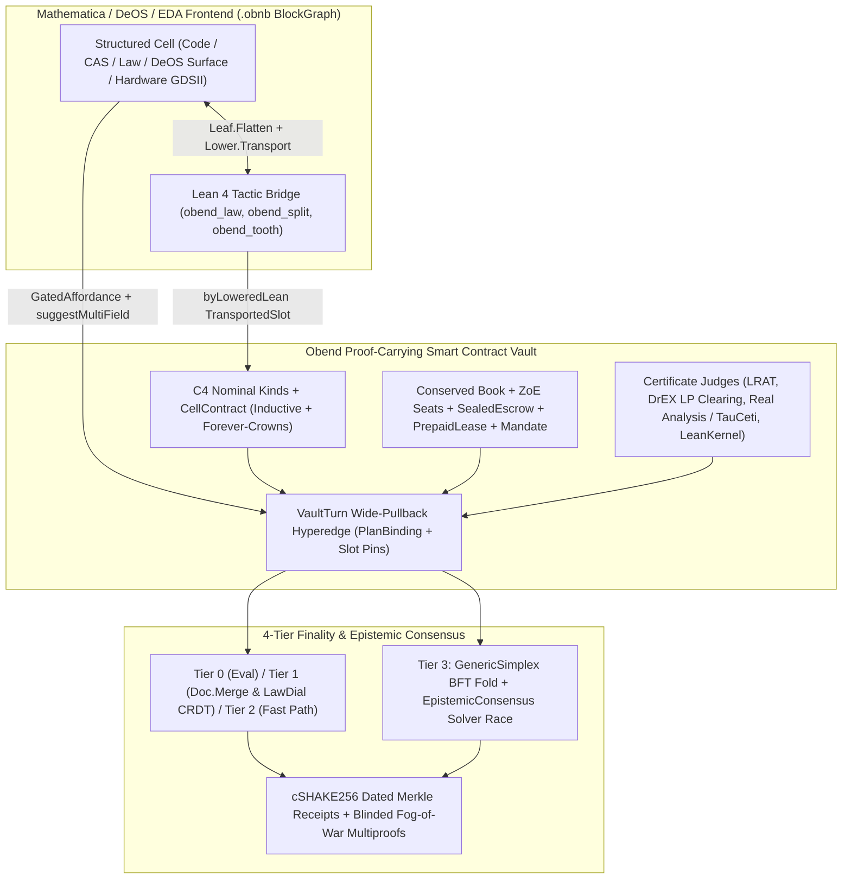

# Unified Architectural Blueprint: `Obend` + `minidregg` + `Dregg2`/`DeOS` as "The Next Mathematica"

> [!IMPORTANT]
> **Design Thesis (`Predicate ⊣ Witness`)**
> Across notebooks, proof-carrying smart contracts, distributed consensus, DeOS surfaces, and EDA/CAD flows, `Obend` already possesses the four foundational primitives—[`Core.Data`](file:///Users/ember/dev/obend/lean/Obend/Core/Value.lean), [`Slot`](file:///Users/ember/dev/obend/lean/Obend/Slot.lean)/[`Intention`](file:///Users/ember/dev/obend/lean/Obend/Intention.lean), [`Fold.Admission`](file:///Users/ember/dev/obend/lean/Obend/Fold.lean) + [`Judge`](file:///Users/ember/dev/obend/lean/Obend/Judge.lean), and [`Receipt.Dated`](file:///Users/ember/dev/obend/lean/Obend/Receipt.lean) (`∨ HashBytes.Collision H`).
> Rather than bolting on parallel engines (which caused the three-headed twin wall in `breadstuffs`), every capability from `minidregg`, `Dregg2`, and `DeOS`—plus fluid Lean 4 tactic reflection and structured GUI/CAD projections—absorbs cleanly into those four primitives.

---

## 1. Full Audit of `Obend`: Untouched Subsystems vs. Recent Bursts

In the past ~8 hours (`git log --since="8 hours ago"`), changes were concentrated in 6 areas:
1. `lean/Obend/Hardware/*` (*owned by the parallel hardware session; treated as strictly read-only here*),
2. [`Obend/Lower/{Syntax,Transport,Fragment}.lean`](file:///Users/ember/dev/obend/lean/Obend/Lower/Transport.lean) (first-order lowering to `LExpr`, `transportSlot`, `readTheoremDecider`),
3. [`Obend/Leaf/BendTT.lean`](file:///Users/ember/dev/obend/lean/Obend/Leaf/BendTT.lean) (`book_to_bendtt_sound`),
4. [`Obend/Logic/Turn.lean`](file:///Users/ember/dev/obend/lean/Obend/Logic/Turn.lean) (notebook derivation turns),
5. [`Obend/Spec/LawDial.lean`](file:///Users/ember/dev/obend/lean/Obend/Spec/LawDial.lean) (`DialVerdict`, `dial_free_confluent`, Bellman-Ford `solveLawWitness_sound`), and
6. [`Obend/Vault/Law.lean`](file:///Users/ember/dev/obend/lean/Obend/Vault/Law.lean) (`suggestMultiField_admits`).

Here is the audit of the **untouched subsystems** across `lean/Obend/`, how they currently participate in the whole system, where they hit a ceiling, and how we can push them much more ambitiously:

| Subsystem & Key Files | Current Role in `Obend` | Current Ceiling / Limitation | Ambitious Upgrade for "The Next Mathematica" & DeOS |
| :--- | :--- | :--- | :--- |
| **1. `Obend/Core/*`** ([`Term.lean`](file:///Users/ember/dev/obend/lean/Obend/Core/Term.lean), [`Value.lean`](file:///Users/ember/dev/obend/lean/Obend/Core/Value.lean), [`Eval.lean`](file:///Users/ember/dev/obend/lean/Obend/Core/Eval.lean), [`Code.lean`](file:///Users/ember/dev/obend/lean/Obend/Core/Code.lean), [`Ty.lean`](file:///Users/ember/dev/obend/lean/Obend/Core/Ty.lean), [`Custody.lean`](file:///Users/ember/dev/obend/lean/Obend/Core/Custody.lean), [`Nominal.lean`](file:///Users/ember/dev/obend/lean/Obend/Core/Nominal.lean)) | Open-recursive Core4 (`mix`, `fix`, `prototype`), Gödel quotation (`quote`/`unquote`, [`Held`](file:///Users/ember/dev/obend/lean/Obend/Core/Code.lean#L906-L949), `heldOf_heldData`), linear/affine [`Custody`](file:///Users/ember/dev/obend/lean/Obend/Core/Custody.lean), `#kind` nominal branding ([`Nominal.lean:49`](file:///Users/ember/dev/obend/lean/Obend/Core/Nominal.lean#L49)). | `Custody` is checked only inside local let-bindings (not across persistent Vault turns); `Data` has `Nat`/`String`/records/variants but no canonical rationals (`ℚ`), polynomials, or dense numeric arrays. | Wire `Custody` into `minidregg`'s conserved resource `Book` across Vault turns (Contract `C2`); add canonical `ℚ`/symbolic-polynomial/tensor encodings over `Data`. |
| **2. `Obend/Elab/*` & `Spec/*`** ([`Parser.lean`](file:///Users/ember/dev/obend/lean/Obend/Elab/Parser.lean), [`Elaborate.lean`](file:///Users/ember/dev/obend/lean/Obend/Elab/Elaborate.lean), [`Spec/Check.lean`](file:///Users/ember/dev/obend/lean/Obend/Spec/Check.lean), [`LawCompile.lean`](file:///Users/ember/dev/obend/lean/Obend/Spec/LawCompile.lean)) | Parses `.obend` packages, elaborates `self`/`super`, checks `given`/`ensures`, compiles surface `LawExpr` to 3-arg Core4 lambdas. | [`LawCompile.compile`](file:///Users/ember/dev/obend/lean/Obend/Spec/LawCompile.lean#L56-L62) emits inlined `ifBool` trees that **always fail** [`Claim.checkKeeps`](file:///Users/ember/dev/obend/lean/Obend/Law/Claim.lean#L97-L101). | Compile surface `law`, `invariant`, and `stepRel` directly into semantic `CellContract` obligations with automatic lowering to `LExpr`. |
| **3. `Obend/Equiv/*`** ([`ObsEq.lean`](file:///Users/ember/dev/obend/lean/Obend/Equiv/ObsEq.lean), [`ApplBisim.lean`](file:///Users/ember/dev/obend/lean/Obend/Equiv/ApplBisim.lean), [`Howe.lean`](file:///Users/ember/dev/obend/lean/Obend/Equiv/Howe.lean), [`Contextual.lean`](file:///Users/ember/dev/obend/lean/Obend/Equiv/Contextual.lean)) | Howe's method proving applicative bisimilarity equals contextual equivalence (`applBisim_iff_ctxEq`). | Sits purely as offline metatheory; not connected to `Logic/Obligation` or `Slot` pin survival. | Add a `byBisim` constructor to `Obligation.Justification` so bisimilar prototype refactors preserve downstream `Slot` pins without invalidating proofs! |
| **4. `Obend/Law/*`** ([`Admits.lean`](file:///Users/ember/dev/obend/lean/Obend/Law/Admits.lean), [`Combinators.lean`](file:///Users/ember/dev/obend/lean/Obend/Law/Combinators.lean), [`Std.lean`](file:///Users/ember/dev/obend/lean/Obend/Law/Std.lean), [`Claim.lean`](file:///Users/ember/dev/obend/lean/Obend/Law/Claim.lean), [`Proofs/Claim.lean`](file:///Users/ember/dev/obend/lean/Obend/Law/Proofs/Claim.lean)) | 3-arg cell laws `law old new req = .ok ()`, combinators (`both`, `withRelaw`), `Std` (`bounded`, `linearSplit`), `Claim.keeps`. | `keeps` is purely syntactic (`isGuardCond`), rejects `Std.bounded` ([`keeps_tooth`](file:///Users/ember/dev/obend/lean/Obend/Law/Proofs/Claim.lean#L261-L265)), non-inductive, and single-cell. | Supersede `keeps` with **`Obend/Law/Contract.lean`** (`CellContract`: inductive 2-state preservation, `Narrows` forever-crowns, Lean certificates). |
| **5. `Obend/Logic/*`** ([`Rewrite.lean`](file:///Users/ember/dev/obend/lean/Obend/Logic/Rewrite.lean), [`Obligation.lean`](file:///Users/ember/dev/obend/lean/Obend/Logic/Obligation.lean), [`Program.lean`](file:///Users/ember/dev/obend/lean/Obend/Logic/Program.lean), [`Hint.lean`](file:///Users/ember/dev/obend/lean/Obend/Logic/Hint.lean)) | `ClaimObj`, `RStep` (`.run`, `.lateBinding`, `.assoc`, `.composeAssoc`, `.congr`, `.trans`), `Justification` (`byEval`, `byDerivation`, `byCases`, `byStructural`), DFS search (`fuel = 4096`). | Closed to 4 internal strategies; no `Nat` induction, `omega`/`ring`, or AC equality saturation (`super` is inert in claims). | Extend [`Obligation.Justification`](file:///Users/ember/dev/obend/lean/Obend/Logic/Obligation.lean#L28) with `byLoweredLean` and `byExternalJudge` + real analysis (`tauceti` / interval / SOS / Gröbner) & E-Graph judges. |
| **6. `Slot`, `Intention`, `Fold`, `Judge/*`, `Receipt`, `Run/*`** ([`Fold.lean`](file:///Users/ember/dev/obend/lean/Obend/Fold.lean), [`Receipt.lean`](file:///Users/ember/dev/obend/lean/Obend/Receipt.lean), [`Lrat.lean`](file:///Users/ember/dev/obend/lean/Obend/Judge/Lrat.lean), [`Certified.lean`](file:///Users/ember/dev/obend/lean/Obend/Judge/Certified.lean), [`Shared.lean`](file:///Users/ember/dev/obend/lean/Obend/Run/Shared.lean)) | Pinned `Slot`s, `Intention` narrowing, `Fold.Admission`, `Judge`, cSHAKE256 Merkle `Receipt`s (`dated_sound`), `Run.Shared` budgets. | Steps one cell/page at a time; no multi-cell atomic hyperedge turns, symbolic-to-collapsed fold mode, or BFT consensus fold. | Add `Vault/Hyperedge.lean` (`VaultTurn`), `Fold.collapse` (Symbolic $\to$ Full Merkle), and `Consensus/Simplex.lean`. |
| **7. `Obend/Doc/*` & `Vault/*`** ([`Graph.lean`](file:///Users/ember/dev/obend/lean/Obend/Doc/Graph.lean), [`Merge.lean`](file:///Users/ember/dev/obend/lean/Obend/Doc/Merge.lean), [`Section.lean`](file:///Users/ember/dev/obend/lean/Obend/Doc/Section.lean), [`Page.lean`](file:///Users/ember/dev/obend/lean/Obend/Vault/Page.lean), [`Store.lean`](file:///Users/ember/dev/obend/lean/Obend/Vault/Store.lean)) | Pijul pushout CRDT (`merge_comm`, `merge_idem`, `clean_iff`), section `Slot`s, C4 `Kind` inheritance (`kind_law_inherited`). | [`Vault/Page.lean:350`](file:///Users/ember/dev/obend/lean/Obend/Vault/Page.lean#L350) flattens pages into Markdown line-LCS (`diffLines`), losing AST structure for code/CAS/CAD cells. | Extend `Doc.Content` with `Content.cell` carrying `Core.Data` AST quotations (`.obnb` `BlockGraph`), keeping all `Doc/Merge` & `Section` theorems intact. |
| **8. `Obend/Ledger/*` & `Journal/*`** ([`Register.lean`](file:///Users/ember/dev/obend/lean/Obend/Ledger/Register.lean), [`Report.lean`](file:///Users/ember/dev/obend/lean/Obend/Ledger/Report.lean), [`Vault.lean`](file:///Users/ember/dev/obend/lean/Obend/Ledger/Vault.lean)) | Double-entry `ledgerFold`, `tb` judge (`trial-balance@1`), `vault_conserved`, `stitch_twice_refused`. | Single-unit `Int` balances; no `Nat` floor solvency, escrowed `Seat`s, or batch LP clearing. | Absorb `minidregg` `CanonicalResourceKernel` (`Book`), `Kernel/Seat.lean` (ZoE offer safety), and `CertifiedClearing.lean` (DrEX LP judge). |
| **9. `Obend/Leaf/*`** ([`Flatten.lean`](file:///Users/ember/dev/obend/lean/Obend/Leaf/Flatten.lean), [`Residual.lean`](file:///Users/ember/dev/obend/lean/Obend/Leaf/Residual.lean), [`Emit.lean`](file:///Users/ember/dev/obend/lean/Obend/Leaf/Emit.lean), [`Specialize.lean`](file:///Users/ember/dev/obend/lean/Obend/Leaf/Specialize.lean), [`BendTT.lean`](file:///Users/ember/dev/obend/lean/Obend/Leaf/BendTT.lean)) | Prototype flattening (`flatten_sound`), `Book` emission (`book_sound`), `specSlot`, `BTerm` compilation. | Disconnected from `Obend/Lower` (`Lower.Transport.lowerTerm` fails on `self`/`super`). | Pipe `Leaf.Flatten` + `Leaf.Emit.Book` into `Lower.Transport.lowerTerm` so **all** prototype methods lower to `LExpr` with `specSlot` pins! |
| **10. `Obend/Analysis/*` & `Tactic/Tooth.lean`** ([`Impact.lean`](file:///Users/ember/dev/obend/lean/Obend/Analysis/Impact.lean), [`Replay.lean`](file:///Users/ember/dev/obend/lean/Obend/Analysis/Replay.lean), [`Coverage.lean`](file:///Users/ember/dev/obend/lean/Obend/Analysis/Coverage.lean), [`Tooth.lean`](file:///Users/ember/dev/obend/lean/Obend/Tactic/Tooth.lean)) | Static change-impact cone (`impact_complete`), replay, coverage, kernel mutation testing (`#tooth`). | Static prototype cone; not driving incremental UI projection rerendering or interactive counterexample generation. | Unify `Analysis.Impact` + `Lower.methodSupport` with `Deos/Rerender.lean` (`rerender_iff_in_support`) and expose `#tooth` as an interactive notebook counterexample tactic (`obend_tooth`). |

---

## 2. Why `keeps` Isn't Powerful Enough & How `Obend/Law/Contract.lean` Replaces It

### 2.1 Five Structural Limits of [`Obend/Law/Claim.lean`](file:///Users/ember/dev/obend/lean/Obend/Law/Claim.lean) (`keeps`)
1. **Syntactic Identity Fragility**: [`isGuardCond I k`](file:///Users/ember/dev/obend/lean/Obend/Law/Claim.lean#L60-L62) demands that every `.inject "ok"` leaf sits under `.ifBool (.app f (.bound k))` with raw AST equality `termEq f I`. As [`keeps_tooth`](file:///Users/ember/dev/obend/lean/Obend/Law/Proofs/Claim.lean#L261-L265) proves:
   ```lean
   theorem keeps_tooth :
       checkClaim [("small", smallTotal), ("law", bounded unitTy "total" 5)] (.keeps "small" "law") = false := rfl
   ```
   Even `Obend`'s own standard-library law [`Std.bounded`](file:///Users/ember/dev/obend/lean/Obend/Law/Std.lean) is rejected by `checkClaim` because it checks the bound inline rather than calling the named function `smallTotal`!
2. **Rejects 100% of Compiled `.obend` Surface Laws**: [`Obend/Spec/LawCompile.lean:56-62`](file:///Users/ember/dev/obend/lean/Obend/Spec/LawCompile.lean#L56-L62) compiles surface `LawExpr` formulas into inlined boolean/arithmetic `ifBool` trees rather than `.app I (.bound 1)`, so `checkKeeps` always returns `false` on surface-authored laws.
3. **Non-Inductive (Cannot Use $\text{Inv}(\text{old})$)**: [`keeps_step`](file:///Users/ember/dev/obend/lean/Obend/Law/Proofs/Claim.lean#L176-L178) requires the law to establish `Keeps I new` unconditionally from scratch without assuming `Keeps I old`. An inductive transition law like `monotoneNat` (`new.seq ≥ old.seq`) cannot prove `new.seq ≥ 10` from `old.seq ≥ 10` under `keeps`.
4. **Unverified `relaw` Exemption vs. Forever-Crowns**: [`guardedArms`](file:///Users/ember/dev/obend/lean/Obend/Law/Claim.lean#L82-L85) blindly exempts `occasion == "relaw"`, forcing `keeps_step` to assume `rq.field "occasion" ≠ some (.variant "relaw" x)`. It cannot express `Dregg2`'s forever-crown (`crown_eternal` in [`Dregg2/Deos/Hatchery.lean:68-165`](file:///Users/ember/dev/breadstuffs/metatheory/Dregg2/Deos/Hatchery.lean#L68-L165)), where a `relaw` is admitted **if and only if** the new law carries a proof certificate that it refines (`Narrows`) the old law.
5. **Single-Cell Scope**: Cannot express multi-cell conservation, wide-pullback overlap agreement, or 2-safety fog-of-war non-interference.

### 2.2 The Replacement: `Obend/Law/Contract.lean` (`CellContract` & 4-Tier Discharge)
We retain `Claim.checkKeeps` as a **Tier-0 $O(|\text{AST}|)$ syntactic fast path**, and introduce `CellContract`:

```lean
namespace Obend.Law

/-- Semantic predicate satisfaction on `Data`. -/
def Holds (P : Term) (d : Data) : Prop :=
  Evaluates (.app P d.term) (.boolean true)

/-- Law refinement (forever-crown / monotone attenuation): `law₂` admits a subset of `law₁`. -/
def Narrows (law₂ law₁ : Term) : Prop :=
  ∀ old new req, Admits law₂ old new req → Admits law₁ old new req

/-- A proof-carrying inductive contract for a Vault Kind or cell. -/
structure CellContract where
  law       : Term
  invariant : Term
  stepRel   : Term
  inductive_preserves :
    ∀ old new req, Holds invariant old → Admits law old new req → Holds invariant new
  step_sound :
    ∀ old new req, Holds invariant old → Admits law old new req → Admits stepRel old new req
```

Every `CellContract` (and every `relaw` crown requiring `Narrows newLaw oldLaw`) is discharged by a unified `ContractCert` sum with 4 tiers:
- **Tier 0 (`bySyntacticGuard`)**: Discharged by [`Claim.keeps_step`](file:///Users/ember/dev/obend/lean/Obend/Law/Proofs/Claim.lean#L176-L178) when `guardedBy` succeeds.
- **Tier 1 (`byLawDial`)**: Discharged automatically when `law` and `invariant` fall in [`Obend/Spec/LawDial.lean`](file:///Users/ember/dev/obend/lean/Obend/Spec/LawDial.lean)'s difference-constraint/interval fragment.
- **Tier 2 (`byLoweredDecider` / `byLrat`)**: Discharged automatically over bounded domains via [`Obend/Lower/Fragment.lean:449`](file:///Users/ember/dev/obend/lean/Obend/Lower/Fragment.lean#L449) (`readTheoremDecider`) or [`Obend/Judge/Lrat.lean`](file:///Users/ember/dev/obend/lean/Obend/Judge/Lrat.lean).
- **Tier 3 (`byLoweredLean`)**: Popped out to Lean 4 via `Obend/Lower/Reflect.lean`, proved with `obend_law` / `omega` / `ring` / induction, and woven back as a `TransportedSlot` receipt!

---

## 3. Absorbing `minidregg` + `Dregg2`/`DeOS` into `Obend` as a Verifiable Smart Contract System



### 3.1 From `minidregg` (`/Users/ember/dev/minidregg`)
1. **Atomic Multi-Cell Wide-Pullback Turns (`Obend/Vault/Hyperedge.lean`)**:
   - Absorbs [`Kernel/Turn.lean:18-138`](file:///Users/ember/dev/minidregg/Kernel/Turn.lean#L18-L138) (`Hyperedge`, `PullbackConsistent`, `disjoint_footprint_commutes`) and [`Theory/PlanBinding.lean:35-720`](file:///Users/ember/dev/minidregg/Theory/PlanBinding.lean#L35-L720) (`no_toctou_under_footprint_pins`).
   - A `VaultTurn` bundles `readPins : List (String × ByteArray)` (checked by `Obend.Slot`), `writeCells : List CellDelta`, and `occasion : Data`. Every mutated cell $c_i$'s C4-inherited law (`effectiveLaw v c_i` in [`Vault/Store.lean:212`](file:///Users/ember/dev/obend/lean/Obend/Vault/Store.lean#L212)) receives the full turn's boundary map in `req.field "turn"`, enforcing wide-pullback agreement on shared legs while turns with disjoint footprints commute (`vaultTurn_disjoint_commutes`).
2. **Conserved Multi-Asset `Book`, ZoE `Seat`s & Certified DrEX Clearing (`Obend/Ledger/{Book,Seat}.lean`, `Obend/Judge/Clearing.lean`)**:
   - Absorbs [`Theory/CanonicalResourceKernel.lean`](file:///Users/ember/dev/minidregg/Theory/CanonicalResourceKernel.lean) (`Book` conservation + `Nat` floor solvency, linked to `Obend/Core/Custody.lean`).
   - Absorbs [`Kernel/Seat.lean`](file:///Users/ember/dev/minidregg/Kernel/Seat.lean) (`Offer`, `Give`, `Want`, `ExitRule`, `seat_offer_safety`, `seat_conservation`) as a composable C4 Kind (`seat/_kind.md`).
   - Absorbs [`Kernel/CertifiedClearing.lean`](file:///Users/ember/dev/minidregg/Kernel/CertifiedClearing.lean) as `Judge.Class.Judge OrderBookBatch ClearingWitness ClearingError` (`drex-clearing@1`): untrusted external LP solvers compute optimal ring/partial-fill matchings, and the Lean kernel verifies primal feasibility + dual prices + complementary slackness in $O(N)$.
3. **Generic Simplex BFT Consensus (`Obend/Consensus/Simplex.lean`)**:
   - Absorbs [`Kernel/GenericSimplex.lean`](file:///Users/ember/dev/minidregg/Kernel/GenericSimplex.lean), [`GenericSimplexEngineSafety.lean`](file:///Users/ember/dev/minidregg/Kernel/GenericSimplexEngineSafety.lean), and [`GenericSimplexReceiverSafety.lean`](file:///Users/ember/dev/minidregg/Kernel/GenericSimplexReceiverSafety.lean) ($n = 3f+1$, `NotarizationCert`, `FinalizationCert`, `NullificationCert`, exponential view-timeout backoff, `receiver_no_conflicting_finalization`, `engine_safety`).
   - Wrapped directly as `simplexAdmission : Fold.Admission (SimplexState C) (SimplexMsg C) SimplexRefusal` + `simplexFinalityJudge` (`simplex-finality@1`) chaining finalized block headers into [`Obend.Receipt.Dated`](file:///Users/ember/dev/obend/lean/Obend/Receipt.lean#L395-L420).
4. **4-Tier Finality Ladder & Epistemic Consensus (`Obend/Consensus/{Finality,Epistemic}.lean`)**:
   - Absorbs [`Theory/Confluence.lean`](file:///Users/ember/dev/minidregg/Theory/Confluence.lean), [`Theory/Finality.lean`](file:///Users/ember/dev/minidregg/Theory/Finality.lean), and [`Theory/EpistemicConsensus.lean`](file:///Users/ember/dev/minidregg/Theory/EpistemicConsensus.lean):
     - **Tier 0 (0 RTT)**: Deterministic evaluation & local certificate judges (`Judge.check`).
     - **Tier 1 (0.5 RTT)**: Semilattice CRDTs ([`Doc.Merge`](file:///Users/ember/dev/obend/lean/Obend/Doc/Merge.lean) and [`LawDial.free`](file:///Users/ember/dev/obend/lean/Obend/Spec/LawDial.lean#L178-L267) `joinData`).
     - **Tier 2 (1 RTT)**: Single-owner or disjoint-footprint `VaultTurn` fast path.
     - **Tier 3 (2 RTT)**: Contended multi-party `VaultTurn`s ordered by `GenericSimplex`.
     - **Epistemic Consensus (`epistemic_agreement`)**: Multiple agents/solvers racing to prove a `ClaimObj`, synthesize a `LawDial` repair witness, or optimize an EDA placement submit certificates; deterministic cost + `Shake256` digest tie-breaking guarantees every node converges on the exact same winning witness without coordination rounds.

### 3.2 From `breadstuffs` (`Dregg2/Deos` & `starbridge-v2`)
1. **House Capacities as C4 Kinds (`Obend/Vault/Escrow.lean`)**: Ports [`SealedEscrow.lean`](file:///Users/ember/dev/breadstuffs/metatheory/Dregg2/Deos/SealedEscrow.lean), [`PrepaidLease.lean`](file:///Users/ember/dev/breadstuffs/metatheory/Dregg2/Deos/PrepaidLease.lean) (fused meter⊗draw wired to `Obend/Run/Shared.lean` budgets), [`Vault.lean`](file:///Users/ember/dev/breadstuffs/metatheory/Dregg2/Deos/Vault.lean) (no-dilution share vault), and [`StandingObligation.lean`](file:///Users/ember/dev/breadstuffs/metatheory/Dregg2/Deos/StandingObligation.lean).
2. **Gated Affordances & Fire-Program Agreement (`Obend/Vault/Affordance.lean`)**: Ports [`GatedAffordance.lean`](file:///Users/ember/dev/breadstuffs/metatheory/Dregg2/Deos/GatedAffordance.lean) + [`FireProgramAgreement.lean`](file:///Users/ember/dev/breadstuffs/metatheory/Dregg2/Deos/FireProgramAgreement.lean) (`installedProgram_gate_eq_surface_stateGate`) wired to [`Obend/Vault/Law.lean:242-290`](file:///Users/ember/dev/obend/lean/Obend/Vault/Law.lean#L242-L290) (`suggestMultiField_admits`) so disabled UI controls show constructive multi-field repair deltas and ancestor `{by, reason}` refusal badges.
3. **Fog-of-War Blinded Merkle Projections & Rehydration (`Obend/Vault/Projection.lean`)**: Ports [`FogOfWar.lean`](file:///Users/ember/dev/breadstuffs/metatheory/Dregg2/Deos/FogOfWar.lean), [`Rerender.lean`](file:///Users/ember/dev/breadstuffs/metatheory/Dregg2/Deos/Rerender.lean), and [`Rehydration.lean`](file:///Users/ember/dev/breadstuffs/metatheory/Dregg2/Deos/Rehydration.lean) on top of [`Obend.Receipt.blind`](file:///Users/ember/dev/obend/lean/Obend/Receipt.lean) so redacted views still carry stranger-checkable cSHAKE256 Merkle multiproofs of the unredacted Vault root.
4. **Powerbox & Confined Agent Mandates (`Obend/Vault/Mandate.lean`)**: Ports [`Dregg2/Agent/Mandate.lean`](file:///Users/ember/dev/breadstuffs/metatheory/Dregg2/Agent/Mandate.lean) + [`starbridge-v2/src/powerbox.rs`](file:///Users/ember/dev/breadstuffs/starbridge-v2/src/powerbox.rs) + [`resident_agent.rs`](file:///Users/ember/dev/breadstuffs/starbridge-v2/src/resident_agent.rs) onto [`Obend/Intention.lean`](file:///Users/ember/dev/obend/lean/Obend/Intention.lean) (`narrow_sound`) and [`Obend/Run/Fork.lean`](file:///Users/ember/dev/obend/lean/Obend/Run/Fork.lean).

---

## 4. Fluid Lean 4 Metaprogramming & Tactic Bridge ("Pop Out to Lean, Weave Back In")

### 4.1 Closing the Prototype Lowering Gap (`Obend/Lower/Reflect.lean`)
Currently, [`Obend/Lower/Transport.lean:174-235`](file:///Users/ember/dev/obend/lean/Obend/Lower/Transport.lean#L174-L235) (`lowerTerm : LayoutEnv → Term → Option LExpr`) lowers first-order Core4 `Term`s to [`LExpr`](file:///Users/ember/dev/obend/lean/Obend/Lower/Syntax.lean#L60-L95) and proves [`lowerTerm_complete`](file:///Users/ember/dev/obend/lean/Obend/Lower/Transport.lean#L345-L398) and [`transportSlot`](file:///Users/ember/dev/obend/lean/Obend/Lower/Transport.lean#L611-L613), but returns `none` on open-recursive `self`/`super` prototypes.
- **The Unification**: Pipe [`Obend/Leaf/Flatten.lean:374`](file:///Users/ember/dev/obend/lean/Obend/Leaf/Flatten.lean#L374) (`flatten_sound`) and [`Obend/Leaf/Emit.lean:345`](file:///Users/ember/dev/obend/lean/Obend/Leaf/Emit.lean#L345) (`Book`, `book_sound`) into `lowerTerm`. Flattening statically resolves all C4 `self`/`super` dispatch into first-order `Book` definitions guarded by [`Obend/Leaf/Specialize.lean:88`](file:///Users/ember/dev/obend/lean/Obend/Leaf/Specialize.lean#L88) (`specSlot`), which then lower 100% cleanly via `lowerTerm` into `LExpr`!

### 4.2 Custom Lean 4 Tactics & Elaborators (`Obend/Tactic/Weave.lean`)
1. **`obend_unfold` / `@[obend_denote]`**: Normalizes `LExpr.denote env e` into native Lean 4 `Nat`/`Int`/`Bool`/`String`/`Prod` expressions so the user/agent sees clean mathematical goals (`new_bal = old_bal - amt ∧ new_bal ≤ ceiling`) with zero `Option.bind` or de Bruijn noise.
2. **`obend_law`**: Takes a `CellContract` or `ClaimObj` goal, elaborates the `LayoutEnv`, applies `Lower.Transport.transportTheorem`, introduces named hypotheses (`h_inv`, `h_law`), runs `obend_unfold`, and attempts `omega | ring | decide`.
3. **`obend_split`**: Case-splits `LExpr.ifE` and `LExpr.caseE` branches while naming each Lean subgoal after the `.obend` surface occasion/variant label.
4. **`obend_tooth`**: Runs [`Obend/Tactic/Tooth.lean`](file:///Users/ember/dev/obend/lean/Obend/Tactic/Tooth.lean) + [`LawDial.solveLawWitness`](file:///Users/ember/dev/obend/lean/Obend/Spec/LawDial.lean#L365-L380) to exhibit a concrete counterexample `Data` record inside the notebook whenever an invariant or law fails.
5. **Weaving Back In (`Justification.byLoweredLean`)**: Adding `| byLoweredLean (layout : Lower.LayoutEnv) (lowered : Lower.LExpr) (support : List String) (receipt : ByteArray)` to [`Obend/Logic/Obligation.lean:28`](file:///Users/ember/dev/obend/lean/Obend/Logic/Obligation.lean#L28) binds the proved Lean theorem to a [`TransportedSlot`](file:///Users/ember/dev/obend/lean/Obend/Lower/Transport.lean#L596-L613) whose pins are `methodSupport ++ specSlot.pins`. If an ancestor prototype overrides any method in `support`, [`moved_pin_blocks`](file:///Users/ember/dev/obend/lean/Obend/Leaf/Specialize.lean#L140-L165) automatically transitions the notebook cell's badge from `usable` to `blocked (stale support: ...)`!

---

## 5. Custom Non-Markdown Structured Document & Projection Format (`.obnb` / `BlockGraph`)

To replace [`Obend/Vault/Page.lean:350`](file:///Users/ember/dev/obend/lean/Obend/Vault/Page.lean#L350)'s flat Markdown line-LCS (`diffLines`) without breaking any theorem in [`Obend/Doc/Merge.lean`](file:///Users/ember/dev/obend/lean/Obend/Doc/Merge.lean) (`merge_comm`, `merge_idem`, `clean_iff`) or [`Obend/Doc/Section.lean`](file:///Users/ember/dev/obend/lean/Obend/Doc/Section.lean) (`unrelated_edit_preserves_sec`), we store rich ASTs via their canonical `Obend.Core.Data` quotation ([`Core.Code.heldData`](file:///Users/ember/dev/obend/lean/Obend/Core/Code.lean#L906-L909), proved lossless by `heldOf_heldData` at L940–949), which satisfies `[DecidableEq, Repr]`:

```lean
namespace Obend.Doc

inductive ProjectionKind where
  | prose | obendCode | casSymbolic | leanBridge | lawContract
  | deosAffordance (action : String)
  | hardwareSchematic | hardwareTiming | hardwareLayout | ledgerSeat
  deriving DecidableEq, Repr

inductive Content where
  | text  (s : String)
  | cite  (target : DocId) (anchor : Option String)
  | field (key : String) (val : String)
  | cell  (id : String) (kind : ProjectionKind) (ast : Obend.Core.Data)
          (pins : List (String × ByteArray)) (receipt : Option ByteArray)
  deriving DecidableEq, Repr
```

- **Read-Only EDA/CAD Integration (`Obend/Vault/HardwareProjection.lean`)**: Without touching a single file in `lean/Obend/Hardware/*`, this adapter projects `Hardware.Schema.Circuit`, `Hardware.Gate.GateNetlist`, `Hardware.STA.TimingReport`, `Hardware.Place.Placement`, `Hardware.Route.RoutedDesign`, `Hardware.DRC.DRCReport`, and `Hardware.GDSII.GDSLibrary` into `Content.cell` `Data` payloads—allowing the notebook GUI to render interactive gate schematics, timing slack histograms, and 2D GDSII layout geometry with clickable DRC violation markers backed by [`Hardware.Fold`](file:///Users/ember/dev/obend/lean/Obend/Hardware/Fold.lean) receipts.

---

## 6. Cross-Platform, Low-Build-Time GUI + Lean 4 C-ABI FFI & 5-Phase Plan

### 6.1 Avoiding `breadstuffs`'s FFI & Build Pitfalls
1. **Lean `mimalloc` Thread-Local Heap Safety**: As discovered in [`dregg-lean-ffi/src/lean_direct.rs:19-33`](file:///Users/ember/dev/breadstuffs/dregg-lean-ffi/src/lean_direct.rs#L19-L33), calling Lean `@[export]` functions from uninitialized GUI/render threads segfaults `mimalloc`. The GUI host must route all calls through a dedicated persistent Lean worker thread pool initialized once via `lean_initialize_thread()`.
2. **8-Function Zero-Copy `ByteArray` C-ABI (`Obend/FFI/Bridge.lean`)**: Because `Obend` already serializes `Data`, turns, projections, and receipts into canonical `ByteArray`s, we avoid `breadstuffs`'s 5,011-line `build.rs` and expose just **8 `@[export]` functions** (`obend_session_new`, `obend_apply_turn`, `obend_cell_eval`, `obend_view_affordances`, `obend_cell_pop_lean`, `obend_cell_weave_cert`, `obend_hw_project`, `obend_receipt_verify`).
3. **GUI Stack Options**:
   - **Thin Rust `wgpu`/`vello` or Tauri v2 + WebGPU Canvas over a 200-line `obend-ffi` crate**: **~20s cold, ~1s incremental**, convenient for embedding Monaco for the live Lean 4 LSP infoview alongside a WebGPU CAD canvas.

### 6.2 Tidy 5-Phase Implementation Sequence
1. **Phase 1 (Semantic Contracts & Lean Tactic Bridge)**: `Obend/Law/Contract.lean` (`CellContract`, `Narrows`) + `Obend/Lower/Reflect.lean` (`Leaf.Flatten` $\to$ `Lower.Transport.lowerTerm`) + `Obend/Tactic/Weave.lean` (`obend_unfold`, `obend_law`, `obend_split`, `obend_tooth`, `byLoweredLean`).
2. **Phase 2 (Smart Contract Vault & DrEX Clearing)**: `Obend/Vault/Hyperedge.lean` (`VaultTurn`, `PlanBinding`) + `Obend/Ledger/{Book,Seat}.lean` + `Obend/Judge/Clearing.lean` (`drex-clearing@1`).
3. **Phase 3 (DeOS Surfaces, Blinded Projections & Agent Mandates)**: `Obend/Vault/{Escrow,Affordance,Projection,Mandate}.lean` (`GatedAffordance` + `suggestMultiField_admits`, `FogOfWar` over `Receipt.blind`, `Mandate`).
4. **Phase 4 (Simplex BFT, 4-Tier Finality & Epistemic Consensus)**: `Obend/Consensus/{Simplex,Finality,Epistemic}.lean` + `Obend/Fold/Collapse.lean` (Symbolic $\to$ Full Merkle collapse).
5. **Phase 5 (`.obnb` Structured Cells, Read-Only Hardware Projections & GUI FFI)**: `Obend/Doc/Structured.lean` (`Content.cell`), `Obend/Vault/HardwareProjection.lean`, and `Obend/FFI/Bridge.lean` + `obend-gui`.
