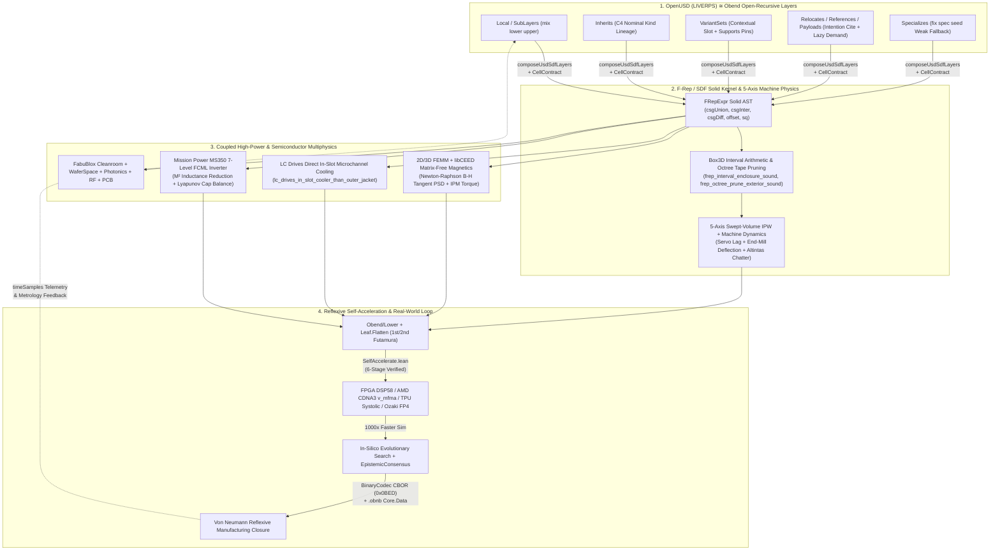

# Physical

If [`AMBITION.md`](AMBITION.md) states what Objective Bend is as a symbolic, analytic, and
coordination calculus—what comes after Mathematica and smart contract languages—this document states
its physical counterpart: **what comes after CAD, CAM, FEA, and EDA when physical parts,
continuous-time multiphysics, machine tools, and semiconductor/mechanical fabrication live inside the
same open-recursive, proof-carrying kernel.**

Our physical ambition, coherently extrapolated, is to close the loop between **formal mathematical
proof**, **in-silico evolutionary design search**, **self-accelerating silicon**, and **physical
manufacturing in the real world**:

1. Every physical component—from a 180nm mixed-signal die on [`WaferSpace`](lean/Obend/Hardware/WaferSpace.lean)
   or a 40m FT8 transceiver PCB ([`RF.lean`](lean/Obend/Hardware/RF.lean), [`PCB.lean`](lean/Obend/Hardware/PCB.lean))
   to an **LC Drives** direct in-slot liquid-cooled permanent-magnet traction motor
   ([`Magnetics.lean`](lean/Obend/Hardware/Magnetics.lean), [`FluidThermal.lean`](lean/Obend/Hardware/FluidThermal.lean)),
   a **Mission Power `MS350`** 350 kW 7-level Flying-Capacitor Multilevel (`FCML`) SiC solar inverter
   ([`PowerElectronics.lean`](lean/Obend/Hardware/PowerElectronics.lean)), or a 5-axis CNC milling
   cell ([`GeometryCAM.lean`](lean/Obend/Hardware/GeometryCAM.lean), [`Mechanics.lean`](lean/Obend/Hardware/Mechanics.lean))—is
   an open-recursive `Obend` object whose geometry, material laws, datasheet envelopes, toolpaths,
   and temporal lifecycle (`timeSamples`) are first-class values.
2. We model **the machinery itself**—ballscrew servo lag, cantilever end-mill deflection,
   Yusuf Altintas's regenerative chatter stability lobes, plasma-etch aspect-ratio-dependent bread-loafing,
   and thermal rotor growth—so that **the simulator predicts the physical cut or etch more faithfully
   than the machine controller executes its own G-code or recipe.**
3. Because [`Obend/Lower`](lean/Obend/Lower/Proofs/SelfAccelerate.lean) lowers verified Lean 4 and
   `Core4` multiphysics/geometry kernels directly into `Leaf.Book` supercombinators, synthesized FPGA
   RTL (`DSP58` cascades), AMD `CDNA3`/`RDNA3` Wavefront + `v_mfma` Matrix-Core ISA, TPU systolic
   arrays, and Ozaki Base-13 `FP4` Tensor Cores ([`Accelerators.lean`](lean/Obend/Hardware/Accelerators.lean)),
   **we compile our physics and geometry solvers directly into the hardware substrate accelerating
   our evolutionary design searches.**

---

## 1. The Claim: Why Twentieth-Century CAD, CAM, FEA, and EDA Cannot Close the Loop

Industrial physical engineering is currently fractured across four incompatible, unverified silos:

1. **Fragile B-Rep Geometry Kernels Crash Under Evolutionary Search**:
   Legacy C++ Boundary-Representation (`B-Rep` / NURBS) kernels (`Parasolid`, `ACIS`, `OpenCASCADE`)
   represent solids as mutable pointer graphs of trimmed surfaces and topological half-edges glued
   together by floating-point tolerances. When an automated evolutionary or gradient-based search
   mutates a cooling channel or fillets a stator tooth, 10–30% of candidate geometries fail with
   non-manifold edge exceptions or self-intersecting boolean crashes.
2. **CAM Simulates Idealized Teleporters, Not Physical Machine Tools**:
   Conventional CAM post-processors emit `G01`/`G02` coordinates assuming an infinitely stiff spindle
   tracing a zero-lag polyline. In reality, high-speed 5-axis milling is governed by **servo tracking
   lag** ($\tau_{\text{servo}} v_{\text{feed}}$), **cantilever end-mill bending** ($\delta = F_r L^3 / 3EI$),
   **cutter-workpiece engagement (`CWE`) transients**, and **regenerative chatter** (Altintas–Budak
   stability lobes). Because the CAM tool does not model the machine's compliance and dynamics, human
   machinists must babysit prove-outs at 20% feed override.
3. **Siloed Multiphysics Solvers With No Compositional Certificates**:
   Designing a high-torque-density electric machine or a 350 kW multilevel inverter requires coupling
   2D/3D nonlinear magnetostatics ($\nabla \cdot (\nu(\|\mathbf{B}\|^2) \nabla A_z) + J_z = 0$),
   conjugate microchannel fluid-thermal convection, high-$dI/dt$ commutation-loop inductances, and
   high-speed carbon-fiber rotor containment. Existing tools (from single-maintainer 2D magnetics codes
   like David Meeker's `FEMM` to commercial multiphysics suites) pass untyped meshes and CSV tables
   across boundaries with zero machine-checkable proof that thermal growth does not close the magnetic
   air gap or demagnetize the NdFeB rotor magnets.
4. **No Temporal Persistence or Compositional Scene Metatheory**:
   A physical part is not a static `.step` or `.stl` file; it is an evolving entity across time—from
   raw billet (`t = 0`), roughing and finishing toolpaths (`t = 1..k`), sub-assembly mating, and
   dyno calibration to years of field telemetry and wear. Pixar/Apple's **OpenUSD** (`Universal Scene
   Description`) solved non-destructive multi-layer scene composition (`LIVERPS`) and temporal
   `timeSamples` for visual effects and `UsdPhysics`, but its C++ `Pcp` engine lacks a formal
   metatheory, cannot execute open-recursive physical laws (`self`/`super`) when a layer overrides a
   parameter, and represents geometry as static polygon meshes rather than verified implicit solids.

---

## 2. The Double-`SDF` Synthesis: `Obend` as Verified OpenUSD (`Sdf`) $\times$ Implicit Solids (`SDF`)

One of the deepest structural alignments in Objective Bend is that **OpenUSD's composition architecture
is an informal special case of `Obend`'s mechanized `Core4` + `C4` + `Slot` + `Leaf` calculus**—and
unifying OpenUSD's **`Sdf`** (*Scene Description Foundations*: layers, paths, `LIVERPS`, `timeSamples`,
binary `.usdc` crates) with mathematical **`SDF`s** (*Signed Distance Fields* / Function Representations
$f : \mathbb{R}^3 \to \mathbb{R}$, as in Matt Keeter's `fidget`) gives us a verified physical scene
and solid-modeling kernel ([`Obend/Hardware/GeometryCAM.lean`](lean/Obend/Hardware/GeometryCAM.lean)):

### 2.1 The Exact Correspondence Between OpenUSD (`LIVERPS`) and `Obend`

| OpenUSD Concept (`pxr/usd`) | `Obend` Mechanized Primitive | Proved Theorem / Module |
| :--- | :--- | :--- |
| **`L` — Local / SubLayers** | `Term.mix lower upper` (`λself. λsuper. upper self (lower self super)`) | `liverps_local_dominates_nonlocal` ([`GeometryCAM.lean`](lean/Obend/Hardware/GeometryCAM.lean)), `late_binding` ([`LateBinding.lean`](lean/Obend/Logic/LateBinding.lean)) |
| **`I` — Inherits (Class Prims)** | C4 Nominal `#kind` Inheritance + Broadcast Law Inheritance | `kind_law_inherited` ([`Vault/Store.lean`](lean/Obend/Vault/Store.lean)), [`Spec/C4.lean`](lean/Obend/Spec/C4.lean) |
| **`V` — VariantSets** | Contextual `Slot` with `Supports` pins & `Candidate` selection | `stale_iff_blocked`, `moved_pin_blocks` ([`Slot.lean`](lean/Obend/Slot.lean), [`Leaf/Specialize.lean`](lean/Obend/Leaf/Specialize.lean)) |
| **`E` / `R` — Relocates & References** | `Intention` (`Cite`, `KindPin`, `resolve` / `recite` / `renew`) | [`Intention.lean`](lean/Obend/Intention.lean) |
| **`P` — Payloads (Deferred Load)** | Call-by-need lazy demand machine (unreferenced sub-assemblies cost 0 ticks) | `demand_is_least` ([`Equiv/Demand.lean`](lean/Obend/Equiv/Demand.lean)) |
| **`S` — Specializes (Weak Template)** | `seed` in `fix spec seed` (globally weakest fallback; `self` late-binds to final prim) | `liverps_specializes_globally_weakest` ([`GeometryCAM.lean`](lean/Obend/Hardware/GeometryCAM.lean)) |
| **`UsdSdfModifier` Geometry Layers** | Non-destructive `.subtractFeature` (`csgDiff super fCut`), `.unionBoss`, `.offsetShell` | `usd_subtract_feature_monotone` ([`GeometryCAM.lean`](lean/Obend/Hardware/GeometryCAM.lean)) |
| **`timeSamples` Temporal Tracks** | Causal lifecycle tracks (`t = 0` billet $\to$ roughing $\to$ finishing $\to$ field telemetry) | `lookupTimeSample`, `golden_openusd_liverps_sdf_verified` ([`GeometryCAM.lean`](lean/Obend/Hardware/GeometryCAM.lean)) |
| **`.usda` (ASCII) / `.usdc` (`Crate` Binary)** | `.obend` surface syntax / `.obnb` (`Core.Data`) + RFC 8949 Binary CBOR (`Tag 0x0BED`) | `decode_encode_binaryHwCert` ([`Hardware/Codec.lean`](lean/Obend/Hardware/Codec.lean)) |

### 2.2 Why Futamura-Specializing OpenUSD + `F-Rep` in `Obend` Changes Everything
In Pixar's C++ OpenUSD, composing a deep `LIVERPS` hierarchy happens at runtime via pointer chasing,
and geometry is a bag of triangles. In `Obend`:
1. A physical assembly (e.g., an LC Drives stator core with 48 slots, where a `VariantSet` selects
   `inSlotMicrochannel` cooling and a `Local` layer subtracts the coolant manifold ports via
   `UsdSdfModifier.subtractFeature`) is a layered `Core4` composition.
2. When the variant pins are fixed, **`Obend/Leaf/Flatten.lean` (`flatten_sound`) + `Obend/Leaf/Residual.lean` (`vtable_clean`)**
   executes the **1st Futamura Projection**: all `LIVERPS` layer lookups, `self`/`super` dispatch, and
   coordinate frame transforms vanish at compile time, emitting a flat, straight-line `FRepExpr` /
   `Leaf.Book` supercombinator tape!
3. That straight-line tape is evaluated over 3D octrees (`Box3D`) using **verified interval arithmetic**
   ([`frep_interval_enclosure_sound`](lean/Obend/Hardware/GeometryCAM.lean#L171-L214),
   [`frep_octree_prune_exterior_sound`](lean/Obend/Hardware/GeometryCAM.lean#L220-L226)—the exact
   mathematical core of Matt Keeter's `fidget`), and lowers via [`Obend/Lower/Proofs/SelfAccelerate.lean`](lean/Obend/Lower/Proofs/SelfAccelerate.lean)
   into native Rust SIMD/JIT (`hardware/rust-ffi`), FPGA `DSP58` pipelines, or AMD `CDNA3` GPU kernels!

---

## 3. Simulating the Machinery Better Than the Tool Runs Itself

To evolve physical designs *in silico* and have the first physical article work out of the box,
we cannot treat manufacturing equipment as an idealized geometry printer. We model the **physics of the
manufacturing machine itself**:

### 3.1 5-Axis CNC Machining: Swept Volumes, Servo Lag, End-Mill Deflection & Altintas Chatter ([`GeometryCAM.lean`](lean/Obend/Hardware/GeometryCAM.lean))
- **Implicit Swept-Volume Material Removal (`evalMachinedWorkpiece`)**:
  As the cutter moves along trajectory $\gamma(t) \in SE(3)$, the in-process workpiece (`IPW`) evolves as
  $f_{\text{IPW}}(p) = \max(f_{\text{stock}}(p), -f_{\text{swept}}(p))$. By
  [`machining_material_monotone_removal`](lean/Obend/Hardware/GeometryCAM.lean#L248-L252), material
  removal is strictly monotone; by [`voxel_no_gouge_sound`](lean/Obend/Hardware/GeometryCAM.lean#L263-L273),
  if the interval evaluation of `fSwept` over a target-part bounding box `B` satisfies `(evalFRepInterval B fSwept).lo > 0`,
  the tool is **mathematically guaranteed never to gouge** any point of the finished part in `B` (zero
  discrete time-step tunneling!).
- **Servo Tracking Lag & Cantilever End-Mill Bending (`evalActualCutterPosNm`)**:
  Under radial cutting force $F_r = k_r a_p h_{\text{chip}}$, the physical cutter tip deviates from the
  commanded G-code coordinate $x_{\text{cmd}}$ by:
  $$x_{\text{cmd}} - x_{\text{actual}} = v_{\text{feed}} \tau_{\text{servo}} + c_{\text{tool}} (k_r a_p h_{\text{chip}}).$$
  The theorem [`machining_governor_bounds_surface_error`](lean/Obend/Hardware/GeometryCAM.lean#L305-L319)
  certifies feed-rate and chip-load governors so that the **true deflected cut** lands inside the
  finished dimensional tolerance band.
- **Altintas–Budak Regenerative Chatter Stability (`checkAltintasChatterStable`)**:
  Self-excited regenerative vibrations destroy surface finish and snap carbide cutters when axial depth
  of cut $a_p$ exceeds the frequency-response stability lobe boundary
  $2 a_p K_f |\operatorname{Re}[G(\omega_c)]| \le C_{\text{lim}}$. The theorem
  [`altintas_chatter_depth_monotone`](lean/Obend/Hardware/GeometryCAM.lean#L334-L349) grounds automated
  axial/radial stepdown scheduling inside the chatter-free envelope.

### 3.2 Semiconductor & Nanofab Process Physics ([`FabuBlox.lean`](lean/Obend/Hardware/FabuBlox.lean), [`DRC.lean`](lean/Obend/Hardware/DRC.lean), [`WaferSpace.lean`](lean/Obend/Hardware/WaferSpace.lean))
- Just as G-code is not the physical part, a GDSII polygon is not the silicon wafer. `Obend` models:
  - **RIE Selectivity & Over-Etch Barrier Punch-Through** (`checkFacilityStep` in [`FabuBlox.lean`](lean/Obend/Hardware/FabuBlox.lean)),
  - **PVD Bread-Loafing & Keyhole Pinch-Off vs. Conformal ALD Trench Fill** (`pvd_high_ar_keyhole_refused` in [`DRC.lean`](lean/Obend/Hardware/DRC.lean)),
  - **FEOL Copper/Gold Cross-Contamination Interlocks** (`facilityCheck_prevents_feol_contamination`),
  - **2D Prouhet–Thue–Morse Common-Centroid Oxide Curvature ($\nabla^2 P$) Cancellation** (`prouhetThueMorse_cancels_linear_and_quadratic_bow` in [`Analog.lean`](lean/Obend/Hardware/Analog.lean)), and
  - **Plasma-Etch Antenna Gate-Oxide Charging & CMP Dishing Density** (`checkWaferSpaceSignoff` in [`WaferSpace.lean`](lean/Obend/Hardware/WaferSpace.lean) for `gf180mcuD`, `sky130A`, and `ihpSg13g2`).

---

## 4. Deep Multiphysics: Magnetics, Direct In-Slot Liquid Cooling, and Multilevel Power

Our physical domain library is built around real, extreme-power hardware systems rather than toy textbook
examples:

1. **2D FEMM-Style Magnetics FEA, Newton-Raphson B-H Saturation & `libCEED` Matrix-Free Contraction ([`Magnetics.lean`](lean/Obend/Hardware/Magnetics.lean))**:
   - Mechanizes first-order triangular finite elements (`FemmTriangle2D`) for $\nabla \cdot (\nu \nabla A_z) + J_z = 0$
     with proved gauge invariance ([`femm_gauge_invariance`](lean/Obend/Hardware/Magnetics.lean#L119-L135)),
     co-energy convexity ([`femm_mesh_energy_nonneg`](lean/Obend/Hardware/Magnetics.lean#L166-L176)),
     Newton-Raphson nonlinear ferromagnetic B-H tangent stiffness positive semi-definiteness
     ([`femm_newton_raphson_tangent_psd`](lean/Obend/Hardware/Magnetics.lean#L357-L367)), and
     **`libCEED` (`arXiv:2103.12881`) matrix-free element operator evaluation** $y_e = G_e^\top (D_e (G_e A_e))$
     ([`femm_matrix_free_nodal_sum_zero`](lean/Obend/Hardware/Magnetics.lean#L386-L401),
     [`femm_matrix_free_energy_identity`](lean/Obend/Hardware/Magnetics.lean#L420-L425))—plus Park/Clarke
     $dq0$ IPM reluctance torque boost ([`ipm_reluctance_torque_boost`](lean/Obend/Hardware/Magnetics.lean#L236-L257))
     and Steinmetz core-loss signoff.
2. **LC Drives (Potsdam, NY) Direct In-Slot Microchannel Stator Cooling ([`FluidThermal.lean`](lean/Obend/Hardware/FluidThermal.lean))**:
   - Models hydraulic manifold mass conservation, Darcy–Weisbach microchannel pressure drop, and
     conjugate heat transfer—proving why **LC Drives' direct in-slot microchannel cooling** (placing
     coolant channels directly inside the stator slot in contact with the conductors, bypassing the
     slot liner and laminated iron tooth/yoke thermal barrier) achieves a $224^\circ\text{C}$ lower
     winding temperature at $8\,\text{kW}$ stator copper loss than a conventional outer water jacket
     ([`lc_drives_in_slot_temp_drop_identity`](lean/Obend/Hardware/FluidThermal.lean#L291-L298),
     [`lc_drives_in_slot_cooler_than_outer_jacket`](lean/Obend/Hardware/FluidThermal.lean#L305-L314),
     [`lc_drives_potsdam_dyno_comparison_verified`](lean/Obend/Hardware/FluidThermal.lean#L321-L329)).
3. **Mission Power / Mission Sun `MS350` 350 kW Flying-Capacitor Multilevel (`FCML`) Solar Inverter ([`PowerElectronics.lean`](lean/Obend/Hardware/PowerElectronics.lean))**:
   - Mechanizes the 7-level ($M = 6$ cell) wide-bandgap SiC/GaN `FCML` phase leg, proving its $6\times$
     switch voltage stress reduction ($1500\,\text{V} \to 250\,\text{V}$) and $M^2 = 36\times$ output
     filter inductance volume reduction ([`ms350_7level_fcml_36x_inductance_and_6x_voltage_reduction`](lean/Obend/Hardware/PowerElectronics.lean#L300-L309)),
     Phase-Shifted PWM natural flying-capacitor charge balance ([`fcml_pspwm_natural_balance`](lean/Obend/Hardware/PowerElectronics.lean#L334-L339)),
     active balancing quadratic Lyapunov contraction ([`fcml_active_balancing_lyapunov_contraction`](lean/Obend/Hardware/PowerElectronics.lean#L367-L382)),
     incremental-conductance MPPT global optimality ([`mppt_incremental_conductance_global_max`](lean/Obend/Hardware/PowerElectronics.lean#L73-L98)),
     laminated busbar $L_{\text{loop}} dI/dt$ surge bounds, and autonomous grid-forming $P\text{--}\omega$
     frequency droop sharing ([`distributed_droop_proportional_power_sharing`](lean/Obend/Hardware/PowerElectronics.lean#L194-L202)).
4. **High-Speed Rotordynamics, Carbon-Fiber Containment & Von Neumann Closure ([`Mechanics.lean`](lean/Obend/Hardware/Mechanics.lean))**:
   - Mechanizes thin-ring centrifugal hoop stress $\sigma_\theta = \rho \omega^2 r^2$ for carbon-fiber
     IPM retention sleeves, Jeffcott supercritical rotor-bearing whirl margin, hot running air-gap
     clearance under combined thermal + centrifugal radial growth ([`hot_air_gap_no_rub_sound`](lean/Obend/Hardware/Mechanics.lean#L156-L163)),
     and self-reproducing robotic factory cell closure ([`von_neumann_reflexive_closure_sound`](lean/Obend/Hardware/Mechanics.lean#L219-L234)).

---

## 5. Reflexive Self-Acceleration: Compiling Our Physics Into the Substrate Accelerating Us

Multiphysics FEA, 3D F-Rep interval octree evaluation, and evolutionary toolpath optimization are
compute-intensive. Because `Obend` can lower Lean terms into `Core4` (`Obend/Lower`), flatten them to
`Leaf.Book` (`Obend/Leaf`), and synthesize hardware (`Obend/Hardware`), **we do not rely on unverified
external C++/CUDA solvers—we compile our verified Lean physics kernels directly into hardware
accelerators** ([`Accelerators.lean`](lean/Obend/Hardware/Accelerators.lean),
[`SelfAccelerate.lean`](lean/Obend/Lower/Proofs/SelfAccelerate.lean)):

1. **Ozaki Scheme Base-13 `FP4 (E2M1)` Tensor-Core Exact Accumulation (`arXiv:2608.06812`)**:
   - [`ozaki_fp4_base13_covers_all_25_digits`](lean/Obend/Hardware/Accelerators.lean#L85-L89) &
     [`ozaki_base13_2limb_product_exact`](lean/Obend/Hardware/Accelerators.lean#L110-L125) prove that
     decomposing integers/mantissas into base-13 limbs over doubled `FP4 (E2M1)` values
     $S_{\text{E2M1}} = \{0, \pm 1, \pm 2, \pm 3, \pm 4, \pm 6, \pm 8, \pm 12\}$ allows ultra-dense 4-bit
     AI Tensor Cores to compute **bit-exact** high-precision multiphysics inner products with zero
     intermediate rounding error.
2. **OCP Microscaling (`MXFP`) + Kulisch Exact Accumulators (`arXiv:2607.13898`), TPU Systolic Arrays & FPGA `DSP58` Cascades**:
   - [`systolic_tpu_eq_dsp58_cascade_eq_kulisch_dot`](lean/Obend/Hardware/Accelerators.lean#L364-L375)
     proves bit-exact equivalence across 2D TPU systolic PE chains, Xilinx UltraScale+/Versal `DSP58`
     `PCIN -> PCOUT` dedicated silicon cascades, and Kulisch exact fixed-point accumulators.
3. **AMD `CDNA3`/`RDNA3` GPU Wavefront ISA & Matrix Cores (`v_mfma`)**:
   - [`compileRtlModuleToAmdGpu`](lean/Obend/Lower/Proofs/SelfAccelerate.lean#L97-L102) and
     [`amd_gpu_mfma_dot4_exact`](lean/Obend/Hardware/Accelerators.lean#L304-L313) compile synthesized
     `RtlModule` datapaths directly into AMD GPU vector/matrix instructions.
4. **The 6-Stage Reflexive Self-Acceleration Theorems ([`SelfAccelerate.lean`](lean/Obend/Lower/Proofs/SelfAccelerate.lean))**:
   - [`lc_drives_thermal_self_accelerates_6stage`](lean/Obend/Lower/Proofs/SelfAccelerate.lean#L156-L176),
     [`ms350_mppt_self_accelerates_6stage`](lean/Obend/Lower/Proofs/SelfAccelerate.lean#L218-L237), and
     [`femm_2d_energy_self_accelerates_6stage`](lean/Obend/Lower/Proofs/SelfAccelerate.lean#L297-L315)
     prove in the Lean 4 kernel that a single physical specification evaluates identically across:
     **(1)** `Lean-lite` `SSteps`, **(2)** `Obend.Core` `Core4.Evaluates`, **(3)** `Obend.Leaf.Book`
     `Halts`, **(4)** synthesized saturating FPGA RTL (`compileBookToRtlSat`), **(5)** compiled AMD
     `CDNA3` GPU Wavefront ISA (`evalCompiledAmdGpuModule`), and **(6)** TPU Systolic / FPGA `DSP58` /
     Ozaki Base-13 `FP4` Tensor-Core execution!

---

## 6. In-Silico Evolutionary Co-Design & The Von Neumann Loop

Because every physical domain in `Obend.Hardware` exposes a total, deterministic kernel `Judge`
backed by compact 39-byte **RFC 8949 Binary CBOR (`Tag 0x0BED`)** and **`.obnb` (`Obend.Core.Data`)**
certificates ([`Codec.lean`](lean/Obend/Hardware/Codec.lean)) across a zero-JSON Rust FFI bridge
([`hardware/rust-ffi`](hardware/rust-ffi/src/lib.rs)):

1. **Swarm Evolutionary Search Under `EpistemicConsensus`**:
   Untrusted evolutionary, genetic, CMA-ES, and gradient-guided agents running on the Rust/GPU host
   propose thousands of candidate mutations to an OpenUSD/`Obend` assembly—varying stator tooth taper,
   in-slot microchannel aspect ratio, `FCML` switching frequency, and 5-axis roughing/finishing
   toolpaths.
2. **Kernel Gatekeeping (`evolutionary_search_emits_only_verified_designs`)**:
   Every candidate is filtered by [`checkCandidateManufacturingSafe`](lean/Obend/Hardware/GeometryCAM.lean#L376-L380)
   and [`checkBinaryHwCert`](lean/Obend/Hardware/Judge.lean): gouging toolpaths, chattering axial cuts,
   excessive end-mill deflections, saturating stator teeth, overheating windings, and over-budget BOM
   swaps ([`AgenticEDA.lean`](lean/Obend/Hardware/AgenticEDA.lean)) are deterministically refused with a
   named `HwClause` witness, while valid Pareto improvements commit into the `Vault` with a
   cSHAKE256 `Receipt.Dated`.
3. **Closing the Real-World Loop (`von_neumann_reflexive_closure_sound`)**:
   Certified designs emit directly as synthesizable SystemVerilog-2012, open-foundry GDSII/OASIS
   signoff packages (`WaferSpace`), Gerber/ODB++ stackups (`PCB`), and deflection/chatter-compensated
   5-axis G-code (`GeometryCAM`). Metrology and dynamometer telemetry from the manufactured part flow
   back into the part's OpenUSD `timeSamples` track in the `Vault`, narrowing the interval enclosures
   for the next evolutionary generation—and laying the formal foundations for a self-improving,
   self-manufacturing physical engineering loop.
