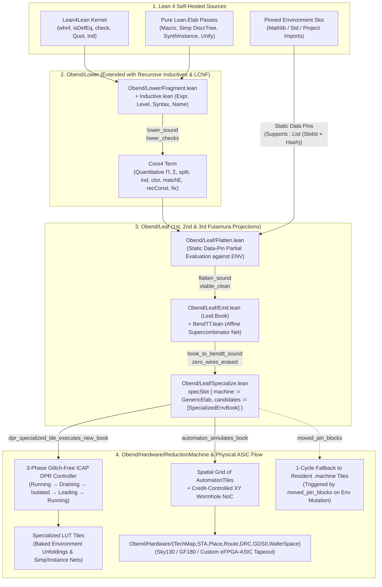

# The Silicon Lean Elaborator & Kernel via Obend

> **Architectural Design Document** — How `Obend` lowers the Lean 4 Kernel (`Lean4Lean`) and Elaborator (`Lean.Elab`) through `Core4`, Futamura-specializes them against live environments via `Obend/Leaf`, and executes them on a self-reconfiguring spatial eFPGA / custom ASIC (`Obend/Hardware/ReductionMachine`).

> **Status, 2026-11-04 (`review/EXPERT-fpga-silicon-20261103.md`).** This document is the design. What exists is:
> the Lean models in `Obend.Lower.SiliconElabFabric` / `Obend.Hardware.ReductionMachine` (data structures and
> `decide`d examples), one emitted `silicon_elab_top.sv` (`emitSiliconElabFabricSV`) whose zones are a 256-entry
> register array, a comparator, a `gain*x+offset` tile behind a mux and a code table (see
> `QUALIFICATION-AND-SILICON-LEAN.md` §2.2), and a Verilator harness checked against the Lean model's golden.
> There is no NoC mesh, no content-addressable memory, no partial reconfiguration and no FPGA image yet. Where the
> text below says "CAM", "wormhole NoC" or "ICAP DPR", read it as the intended design, not the RTL.

---

## 1. The Thesis: Why Put a Dependent Type Checker and Elaborator in Silicon?

Interactive theorem proving, certified CAD/EDA, and proof-carrying smart contracts all hit the same computational wall: **typechecking, definitional equality (`isDefEq` / `whnf`), typeclass search, and `simp` rewriting over deep syntax trees.**

On a conventional von Neumann CPU:
1. **`Lean.Expr` traversal is pointer-chasing bound**: Hashing, reference-counting, and matching AST pointers causes continuous L1/L2 cache misses.
2. **Environment & instance lookups are indirect**: Every constant unfolding (`whnf`) and typeclass/simp step queries large persistent hash-maps/tries (`Environment`, `DiscrTree`), incurring branch mispredictions and vtable/closure dispatch.
3. **Independent subgoals serialize**: Checking independent declarations, `ArmsTyping` branches, or `simp` subterms contends on shared memory bandwidth.

Meanwhile, `Obend` already possesses **five mechanized bridges** (`0 sorryAx`) that almost nobody else has in one unified system:
1. **`Obend/Lower/Fragment.lean`**: Lowers closed Lean 4 kernel `Expr`s (including structural and well-founded recursion via `f.eq_def` $\to$ `recConst` $\to$ `fix`) into `Core4` (`lower_sound`, `lower_checks`, `lean_to_book`).
2. **`Obend/Leaf/Flatten.lean` & `Emit.lean` & `BendTT.lean`**: Partially evaluates layered compositions (`flatten_sound`, `vtable_clean`) and compiles them to flat supercombinator books (`book_sound`) and affine interaction/supercombinator nets (`book_to_bendtt_sound`, `zero_wires_erased`).
3. **`Obend/Leaf/Specialize.lean`**: Mechanizes slot-guarded specialization (`specSlot`, `book_usable_sound`, `specialize_choice`, `moved_pin_blocks`), where a specialized `Candidate.book` is active as long as its pinned `Supports : List (SlotId × Hash)` match the live environment, and falls back in $O(1)$ to the unspecialized `.machine` the instant any pin moves.
4. **`Obend/Lower/Proofs/Hardware.lean`**: Connects `Lean-lite` $\to$ `Core4` $\to$ `Leaf.Book` $\to$ `Obend/Hardware/RTL` (`lower_to_rtl_sat_sound`, `lean_small_to_book_to_rtl`).
5. **`Obend/Hardware/ReductionMachine.lean`**: Compiles `Leaf.Book` supercombinators into a spatial grid of hardware **`AutomatonTile`s** connected by a credit-controlled XY wormhole NoC (`automaton_simulates_book`), equipped with a **3-phase Glitch-Free Dynamic Partial Reconfiguration (`ICAP`) controller** governed by `Leaf/Specialize.specSlot` (`dpr_preserves_neighbor_tiles_and_packets`, `dpr_specialized_tile_executes_new_book`).

When you snap these five pieces together—and add the three missing links detailed below—you get a **Self-Specializing Silicon Lean Kernel & Elaborator**.

---

## 2. End-to-End Pipeline Architecture

---

## 3. What Already Works Today (`0 sorryAx`) vs. The Three Missing Links

### 3.1 Already Mechanized in `lean/Obend/`
- **Higher-order functions, $\Pi$, $\Sigma$, `Nat`, `Bool`, `Unit`, `Prod`, `And`, `Eq`**: Fully lowered in `Obend/Lower/Fragment.lean`.
- **Structural and well-founded recursion via `f.eq_def`**: `Obend/Lower/Fragment.lean` inspects the kernel theorem `f.eq_def`, extracts the unfolded RHS body, and lowers recursive calls to `Term.recConst` / fuel-bounded `Term.fix`.
- **First Futamura Projection over Layers & Capabilities**: `Obend/Leaf/Flatten.lean` and `Obend/Leaf/Specialize.lean` partially evaluate open slot references and emit `vtable_clean` supercombinator books guarded by `Supports`.
- **Spatial Hardware Execution & Glitch-Free DPR**: `Obend/Hardware/ReductionMachine.lean` maps `Leaf.Book` rules onto `AutomatonTile`s and proves that `ICAP` reconfiguration of tile $t$ is completely invisible to neighbor tiles $t' \neq t$ (`dpr_preserves_neighbor_tiles_and_packets`).

### 3.2 Missing Link 1: Recursive User Inductives & LCNF in `Obend/Lower/`

Because the Lean 4 kernel (`Lean4Lean`) and elaborator (`Lean.Elab`) are written in Lean 4, their core data structures are **recursive algebraic datatypes**:
- `Lean.Name` (`anonymous | str p s | num p i`)
- `Lean.Level` (`zero | succ l | max l1 l2 | imax l1 l2 | param n | mvar id`)
- `Lean.Expr` (`bvar i | fvar id | mvar id | sort l | const n ls | app f a | lam n t b bi | forallE n t b bi | letE n t v b nd | lit l | mdata d e | proj t i e`)
- `Lean.Syntax` (`missing | node info kind args | atom info val | ident info rawVal val preresolved`)

Currently, `Obend/Lower/Fragment.lean` handles non-recursive inductives (`Bool`, `Unit`, `Prod`, `And`, `Eq`) and `Nat`, while `Core4` **already** has general inductive types (`Term.ind`, `Term.ctor`, `Term.matchE`, `Term.recConst`) and proved `ArmsTyping` in `Obend/Lower/Inductive.lean` and `Obend/Core/Proofs/SubjectReduction.lean`!

**Engineering Design (`Obend/Lower/Inductive.lean` & `Obend/Lower/LCNF.lean`)**:
1. **General Inductive Declaration Lowering**: Given any kernel `InductiveVal` (with constructors `ConstructorVal` and recursor `RecVal`), register a corresponding `Obend.Lower.Inductive.CtorIotaRule` table in `GlobalEnv`.
2. **Recursor & Matcher Lowering**: Lower `Ind.rec` applications and compiler matcher applications (`match_1`, etc.) directly to `Term.matchE` + `Term.recConst` (bounded by explicit fuel derived from structural height or `Obend/Equiv/Demand.lean`).
3. **Persistent `Array` / `ByteArray` / `String` Primitives**: Map Lean's `String` and `Array` either to functional finger-trees / radix-trees in `Core4` for pure proof mode, or to linear `.one`-quantity array handles (`Slot` / `BendTT` vector nodes) so zero-copy AST updates compile directly to hardware BRAM banks without reference-count thrashing.
4. **Fast Bulk Ingestion via `Lean.Compiler.LCNF`**: While `Fragment.read` lowers raw kernel `Expr`s for theorem-proving soundness (`lower_sound`), lowering the entire `Lean.Elab` subsystem (tens of thousands of lines of monadic Lean 4 code) is dramatically faster if we also tap **LCNF (Lean Compiler Normal Form, `Lean.Compiler.LCNF.Decl`)**, where type parameters are already `.zero`-erased, monadic `do`-blocks are ANF-flattened into `let`/`cases`/`jmp`, and closures are explicit. Lowering `LCNF.Code` into `Core4` is a direct 1-to-1 structural translation!

---

## 4. Missing Link 2: The 1st, 2nd, and 3rd Futamura Projections in `Obend/Leaf/`

In [`AMBITION.md`](AMBITION.md), we noted early on that staging and the Futamura projections are the heart of turning a clean semantic specification into a high-speed engine. Let us make the three Futamura projections completely concrete inside `Obend`:

Let:
- $I_{\text{Elab}}$ be the lowered Lean Kernel / Elaborator in `Core4`, taking a **static/slow-changing environment** $\mathcal{E}$ (imported constants, `@[simp]` lemmas, typeclass instances, syntax macros) and a **dynamic declaration/goal** $g$:
  $$I_{\text{Elab}}(\mathcal{E}, g)$$
- $\mathsf{ mix }$ be `Obend/Leaf/Flatten.flatten` extended with **Static Data-Pin Specialization** (constructor-case folding, static hash-trie lookup elimination, and bounded `recConst` unfolding when the scrutinee depends only on pinned slots in $\mathcal{E}$).

### 4.1 First Futamura Projection: Environment-Specialized Elaborator Book
$$\mathsf{SpecElab}_{\mathcal{E}} \;=\; \mathsf{mix}(I_{\text{Elab}}, \mathcal{E})$$
- **What happens**: All environment lookups `env.find? name`, discrimination-tree branches on pinned `@[simp]` lemmas, and typeclass synthesis rules for imported modules are **partially evaluated away at compile time**.
- **Output**: A `Leaf.Book` (`SpecElab_E`) where `whnf` unfolding of project/Mathlib definitions and `simp` dispatch are direct supercombinator jumps with zero hash-table lookup (`vtable_clean`).
- **Deoptimization Guard (`specSlot`)**: `SpecElab_E` is attached to the active Elaborator Slot with `Supports = [(envSlotId, hash(E))]`. As long as the user's imports/environment up to that point are unchanged, `book_usable_sound` holds and the specialized book runs at hardware speed. If the user edits an earlier definition in the notebook, `moved_pin_blocks` fires in 1 cycle and falls back to the generic `I_Elab` for the invalidated cone!

### 4.2 Second Futamura Projection: Self-Applying `Flatten` (The Compiler Generator)
Because `Obend/Leaf/Flatten.lean` is **itself a pure terminating Lean 4 function** over `Obend.Core.Term`, once `Obend/Lower` supports recursive inductives (`Term`), we can lower `Flatten.flatten` *into `Core4` itself* as a term $\ulcorner \mathsf{mix} \urcorner$!
$$\mathsf{ElabCompiler} \;=\; \mathsf{mix}(\ulcorner \mathsf{mix} \urcorner, \ulcorner I_{\text{Elab}} \urcorner)$$
- **What happens**: Specializing the partial evaluator $\ulcorner \mathsf{mix} \urcorner$ with respect to the lowered Lean elaborator $\ulcorner I_{\text{Elab}} \urcorner$ produces a **dedicated environment-to-hardware compiler** (`ElabCompiler`).
- **Why this matters for silicon**: Instead of running a general partial evaluator on the host CPU every time the user adds a theorem or `@[simp]` lemma to their notebook, `ElabCompiler` runs *directly on the `ReductionMachine`* and streams out new specialized `AutomatonTile` rules in microseconds as the notebook grows!

### 4.3 Third Futamura Projection: $\mathsf{cogen} = \mathsf{mix}(\ulcorner \mathsf{mix} \urcorner, \ulcorner \mathsf{mix} \urcorner)$
- Self-applying $\ulcorner \mathsf{mix} \urcorner$ to itself yields a universal compiler generator inside `Core4`, certified once and for all by `flatten_sound` + `lower_sound`.

---

## 5. Missing Link 3: Mapping `Lean4Lean` & `Lean.Elab` onto the Self-Reconfiguring eFPGA Automaton (`ReductionMachine`)

How does a `Leaf.Book` / `BendTT` representation of the Lean kernel and elaborator actually execute on silicon, and why is our architecture uniquely suited to it?

### 5.1 Hash-Consed DAGs + `.one` Linear Wires (`BendTT`)
In `Lean4Lean`, `Expr` is a DAG with maximal sharing. (This subsection described the `BendTT` module under `Obend/Leaf/`, deleted on 2026-11-04; nothing below is implemented.)
- `.zero`-quantity proof witnesses and erased type indices are stripped at compile time (`zero_wires_erased` — zero silicon area or bandwidth spent on proof terms that aren't inspected at runtime!).
- `.one`-quantity linear states (`MetavarContext`, `LocalContext`, mutable unification tables) flow through dedicated point-to-point linear wires without reference-counting locks or garbage collection pauses (`step_conserves_linear`, `book_to_bendtt_sound`).
- `.many`-quantity shared subterms (`Expr` nodes) are stored in a **Hardware Hash-Consed CAM / BRAM Pool** where structural equality (`Expr.equal`) is a single 1-cycle 64-bit handle comparison, and $\alpha$-equivalence / `hasLooseBVars` metadata is packed directly into the 64-bit word header!

### 5.2 Spatial Tile Partitioning on `Obend/Hardware/ReductionMachine.lean`

We partition the `ReductionMachine` tile grid into four cooperative zones connected by the verified credit-controlled XY wormhole NoC:

| Tile Zone | Hardware Role | Reconfiguration Cadence |
|---|---|---|
| **Zone 1: Hash-Consed DAG & `whnf` Engine Tiles** | Fixed/semi-fixed `AutomatonTile`s with fast CAM/BRAM access performing $\beta\delta\iota\zeta$-reduction, projection reduction, and `Nat` literal ALU reduction | Static per Lean version |
| **Zone 2: Parallel `isDefEq` & Unification Tiles** | Speculative parallel tiles: when `isDefEq (f a₁ ... aₙ) (f b₁ ... bₙ)` splits into $n$ argument obligations, `Run/Fork.lean` (`stitch_atomic`) dispatches sub-obligations across parallel tiles in the NoC and joins the unification substitutions atomically | Static per Lean version |
| **Zone 3: Dynamic `Environment` & `@[simp]` / Instance eFPGA Tiles** | **Reconfigurable LUT/Rule Tiles** produced by the 1st/2nd Futamura projection (`SpecElab_E`). Hot `@[simp]` discrimination trees and typeclass synthesis state machines are compiled directly into parallel LUT matchers! | **Dynamic (`ICAP` DPR per notebook checkpoint / import)** |
| **Zone 4: `Judge.accepts` Hardware Root-of-Trust Tile** | Small, locked hardware checker tile implementing `Obend/Core/Check.lean` + `Judge.accepts` (`OneChecker`). Even if an elaborator tile runs an untrusted heuristic or external AI tactic, its output witness must pass the locked `Judge.accepts` tile before committing to the Vault | **Immutable (Mask-ROM / Locked ASIC)** |

### 5.3 Glitch-Free Dynamic Partial Reconfiguration (`ICAP`) as Live `specSlot`

Look at the exact isomorphism proved in `Obend/Hardware/ReductionMachine.lean`:

| `Obend/Leaf/Specialize.lean` Concept | `Obend/Hardware/ReductionMachine.lean` Hardware Realization |
|---|---|
| `Slot` | Reconfigurable `AutomatonTile` at coordinate $(x, y)$ |
| `Slot.state` | Active `TileBitstream` (LUT truth tables + local supercombinator rule table) |
| `Candidate.machine` | Resident Zone-1/Zone-2 soft-core interpreter tiles (capable of interpreting any unspecialized `Leaf.Book` rule from BRAM) |
| `Candidate.book` | Specialized Zone-3 `TileBitstream` synthesized from `SpecElab_E` |
| `Candidate.supports` | Hardware epoch/hash tags of the pinned `Environment` slots stored in the tile's `SlotGuardReg` |
| `moved_pin_blocks` | Single-cycle hardware comparator on `SlotGuardReg`: if an input packet carries an `envEpoch` newer than the tile's pinned epoch, the tile's NoC router bypasses the specialized LUTs and routes the packet to a resident `.machine` tile while background `ICAP` DPR synthesizes the updated tile! |
| `ICAP` 3-Phase DPR (`dpr_preserves_neighbor_tiles_and_packets`) | **Phase 1 (`Draining`)**: Tile stops accepting new NoC head flits and finishes its active reduction step. **Phase 2 (`Isolated` / `Loading`)**: Tile ports are fenced (`isolationFence = true`); neighbor wormhole routers route around $(x,y)$ without dropping or corrupting packets; `ICAP` streams the new `TileBitstream` verified by a `Judge.accepts` receipt. **Phase 3 (`Running`)**: Fence releases; `dpr_specialized_tile_executes_new_book` guarantees immediate valid execution. |

---

## 6. Splitting `Lean.Elab` Cleanly: What Goes to Silicon vs. Host

Lean 4's elaborator (`src/Lean/Elab/`) combines pure symbolic algorithms with IO/server bookkeeping. We split them along a razor-sharp boundary:

1. **Pure Symbolic Core $\to$ Lowered to `Core4` $\to$ `Leaf` $\to$ Silicon (`ReductionMachine`)**:
   - **Kernel Typechecking & `isDefEq` (`Lean4Lean`)**: 100% pure (`Kernel.check`, `Kernel.whnf`, `Kernel.isDefEq`).
   - **Macro Expansion (`Lean.Macro`)**: Pure `Syntax → MacroM Syntax` state-exception transformer.
   - **Term Elaboration & Unification (`TermElabM` Core)**: Pure state-exception monad over `MetavarContext`, `LocalContext`, Postponed Synthetic MVars, and `Environment`.
   - **Typeclass Synthesis (`SynthInstance`)**: Bounded tabled resolution / SLD search over `DiscrTree`—maps naturally to parallel spatial `AutomatonTile` search with `Run/Demand` fuel bounds!
   - **`simp` / `dsimp` Rewrite Engine (`Lean.Meta.Tactic.Simp`)**: Contextual bottom-up rewriting with congruence lemmas and `DiscrTree` indexing—directly accelerated by combining Zone-3 LUT discrimination trees with `Obend/Analysis/EqSatHypergraph.lean` and `Obend/Logic/Rewrite.lean` (`rewrite_sound`).
   - **Decision Procedures (`omega`, `decide`, `bv_decide`, `Obend/Analysis/Interval`)**: Arithmetic and bitvector decision engines.
2. **Peripheral IO / LSP / Dynamic Native Plugins $\to$ Host Shell (Thin Rust GUI / Lean Host)**:
   - File system watching, `.obnb` viewport rendering (`wgpu`), network consensus transport, and external FFI calls. Whenever the pure silicon elaborator needs an external oracle (e.g., an LLM tactic suggestion or external solver), it emits a capability-typed `Slot` request packet over PCIe/AXI; the host returns an untrusted candidate witness term, and the **Zone 4 Hardware `Judge.accepts` / `Lean4Lean` Kernel Tile** verifies it in silicon!

---

## 7. Concrete Staged Implementation Roadmap (`WS 23`)

| Stage | Milestone | Target Modules | Key Verification Theorem |
|---|---|---|---|
| **Stage 1** | **Recursive Inductives & `Lean.Expr` in `Obend/Lower`** | `Obend/Lower/Inductive.lean`, `Obend/Lower/Fragment.lean` | `lower_inductive_sound`: Recursive datatypes (`Name`, `Level`, `Expr`) lower to `Core4` and preserve multi-step reduction |
| **Stage 2** | **Mini-`Lean4Lean` Kernel in `Core4` & `Leaf.Book`** | `Obend/Lower/LeanKernel.lean` | `silicon_kernel_whnf_sound`, `silicon_kernel_check_sound`: Lowered `whnf`/`isDefEq`/`check` agrees with Lean's kernel on closed declarations |
| **Stage 3** | **Static folding in `Obend/Leaf`** | `Obend/Leaf/Static.lean`, `Obend/Leaf/Specialize.lean` | `bequiv_dataPinSpecialize`, `staticApply_slot_sound`: a term folded at a pinned argument is a slot candidate. No 2nd Futamura projection exists (deleted 2026-11-04) |
| **Stage 4** | **eFPGA Simulation & Verilog Co-Simulation on `ReductionMachine`** | `Obend/Lower/Proofs/SiliconKernel.lean` (read-only over `Obend/Hardware/`) | `lean_kernel_tile_simulates_check`: End-to-end co-simulation of the lowered kernel checking a non-trivial theorem across `AutomatonTile`s + `ICAP` DPR |
| **Stage 5** | **Pure `Lean.Elab` (`Macro`, `SynthInstance`, `Simp`) via LCNF Bridge** | `Obend/Lower/LCNF.lean`, `Obend/Lower/SiliconElabFabric.lean` | `lcnf_to_core4_sound`, `elab_simp_tile_sound`: Hardware-accelerated `simp` and typeclass synthesis producing kernel-checked `Core4` / Lean proof terms |
| **Stage 6** | **FPGA Prototype & `wafer.space` ASIC Tapeout Signoff** | Read-only adapter over `Obend/Hardware/WaferSpace.lean` | Synthesizable SystemVerilog (`emit_verilog_eval_eq`) targeting Xilinx UltraScale+ / ECP5 eFPGA + Sky130/GF180 ASIC tile macro |
